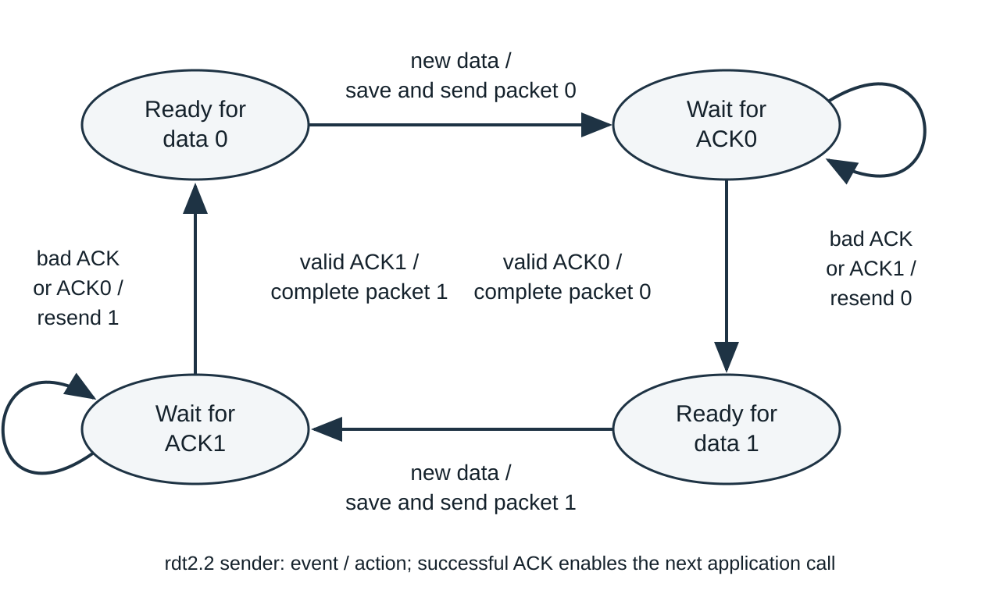
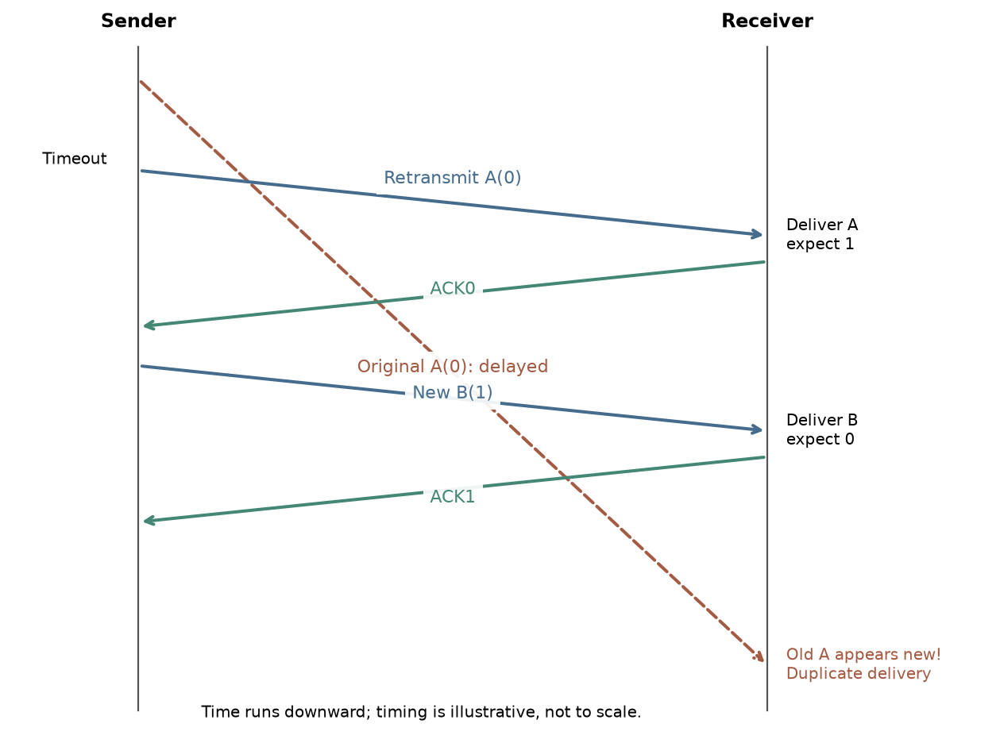
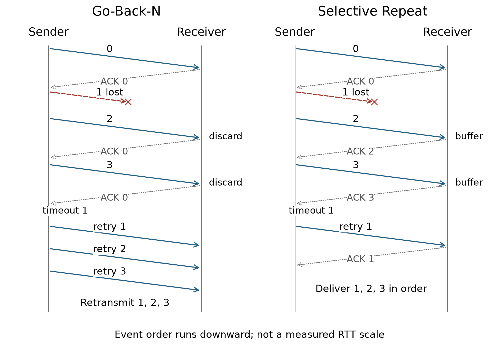
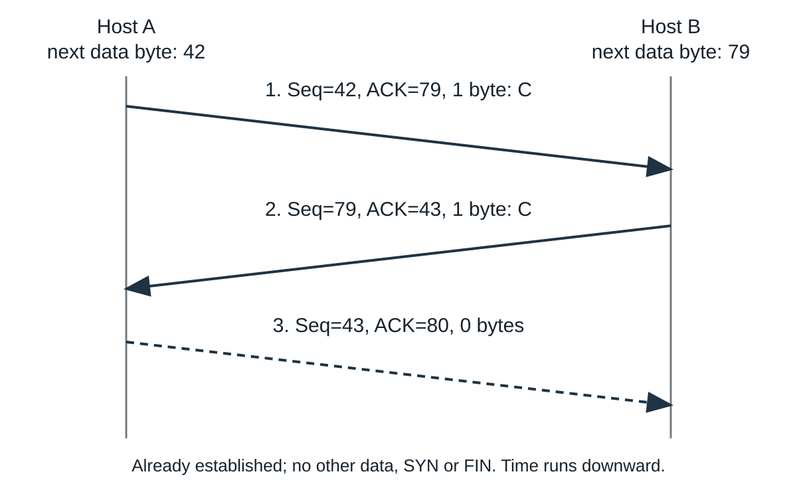

# Chapter 3 · Transport Layer（当前 part 1–2）
## 数据到了电脑，还要交对进程、补齐缺口

[课程目录](README.md) · [上一章：应用层](Chapter02.md) · [Tutorial 5](Tutorial05.md)

同一台电脑可以同时开浏览器、邮件和游戏。网络把数据送到这台电脑之后，还要知道交给哪一个程序。即使地址写对，途中也可能损坏、丢失或重复；收到半段文件不能直接说“差不多齐了”。这一章从进程寻址开始，逐步增加可靠传输需要的机制。

依据当前part1的44页和part2的26页。两份课件的幻灯片序号各自从1开始。目前整理至TCP的RTT与超时；流控、连接管理及拥塞控制待后续材料补充。

**基础补课（可跳过）：** [bit、byte与速率](../../learning/foundation-notes/NetworkBasics.md#units)、[二进制](../../learning/foundation-notes/NetworkBasics.md#binary)、[时间轴](../../learning/foundation-notes/NetworkBasics.md#timeline)。阅读时留意“第几个包”和“第几个字节”的区别，§9会具体比较。

| 主题 | 优先级 | 难度与卡点 | 掌握要求及依据 |
|---|---|---|---|
| 传输服务、复用/解复用 | 核心必会 | 中，主机/进程与端点 | 读UDP/TCP标识与回程端口；Chapter 3 part 1，第4–15张幻灯片、Tutorial 5 Q1–2 |
| UDP与校验和 | 核心必会 | 中，回卷进位 | 手算、解释检测边界；Chapter 3 part 1，第17–20张幻灯片、Tutorial 5 Q3 |
| rdt1.0–3.0 | 核心必会 | 高，双方状态与坏ACK | 逐事件解释、画乱序反例；Chapter 3 part 1，第22–44张幻灯片、Tutorial 5 Q4 |
| 停等与流水线 | 核心必会 | 中，忙碌时间/周期 | 计算利用率与吞吐；Chapter 3 part 2，第1–6张幻灯片 |
| GBN与SR | 核心必会 | 高，ACK与窗口 | 画一次丢包后的行为；Chapter 3 part 2，第7–15张幻灯片 |
| TCP序号与RTO | 核心必会 | 中，字节与估计量 | 算下一序号、累计ACK、超时；Chapter 3 part 2，第17–26张幻灯片 |
| 完整握手/流控/拥塞控制 | 后续待当前材料 | 不以“尚缺”推断不考 | 暂留历史预习，不补成教师已讲 |

[TOC]

## 1. Transport service｜IP找到主机，传输层找到应用端点

先区分网络层的主机间逻辑通信与传输层的进程间逻辑通信。以发送一段应用数据为例：应用层称它为message（消息）；传输层封装后常称segment（报文段）；再封装进网络层的datagram（数据报），通过链路层frame（帧）送到下一站。各层名称强调不同的封装，日常说packet时则需要看上下文。

TCP提供连接上的可靠有序字节流以及流控、拥塞控制；UDP提供较简单的数据报服务。可靠不表示网络永久中断也能永远交付，不表示有固定到达期限，也不等于加密。

**自测 / Check：** 一段数据已经到达正确IP地址，是否已确定交给哪一个浏览器连接？ / Does arrival at the correct host IP identify a specific browser connection?

答案 / Answer

没有。还需传输协议与端口等信息；TCP连接区分还涉及双方IP和端口。 / No. Transport endpoint information is still needed; established TCP connections use both address-port pairs.

来源：Chapter 3 part 1，第4–7张幻灯片。

## 2. Multiplexing and demultiplexing｜同一栋楼有许多门

发送端复用，把多个socket的数据交给网络；接收端解复用，看首部把数据送到相应socket。端口是传输端点标识的一部分，要与IP地址和协议一起理解。

先看一个普通、未连接的UDP接收socket：目的IP与目的端口标识接收socket，不同来源的数据报可以到同一个UDP socket。Chapter 3 part 1，第13张幻灯片的已建立TCP连接按四元组区分：源IP、源端口、目的IP、目的端口。因此服务器端同一个80端口可同时服务多个连接，只要四元组不同。

**跟做 / Worked：** 沿用Tutorial 5 Q2的端口：C:7532→B:80、C:26145→B:80、A:26145→B:80是三条不同TCP连接。回程分别B:80→C:7532、B:80→C:26145、B:80→A:26145。后两者客户端端口相同，客户端IP仍区分连接。 / Using the ports in Tutorial 5 Q2, reverse both address-port pairs for the return direction.

**实现补注：** 这里比较的是课堂的普通UDP接收与已建立TCP连接。监听socket、已接受连接及connected UDP的接口细节，可在实际编程时进一步区分。

**变式 / Transfer：** 两客户端在不同IP上都使用端口50000，连接同一个服务器443端口，是否冲突？ / Two clients with different IP addresses both use source port 50000 to connect to the same server IP and port 443. Do the established TCP connections conflict?

答案 / Answer

四元组不同，不因客户端端口数值相同而冲突。 / No: their source IP addresses distinguish the four-tuples.

来源：Chapter 3 part 1，第9–15张幻灯片；端口数值沿用Tutorial 5 Q2，不与课件第14张的另一组端口混用。

## 3. UDP｜少做承诺，也少保存状态

UDP不先进行TCP式握手，也不内建重传、排序和拥塞控制。应用可以在其上增加所需功能。需要及时性的应用可能愿意舍弃过时数据，但“视频”这个标签不能唯一确定它使用UDP，HTTP自适应视频就是不同情境。

UDP首部四个16bit字段为source port、destination port、length、checksum，合计8byte。length包含UDP首部与载荷，不包含外层IP首部。100byte数据的UDP length是108byte。

**English takeaway:** UDP preserves datagram boundaries but does not provide TCP's built-in reliable ordered byte-stream service. Its length field counts the UDP header and payload.

来源：Chapter 3 part 1，第17–18张幻灯片。

## 4. Internet checksum｜算得对不等于能发现一切错误

校验和采用16bit反码加法。先把校验字段置0，把保护的数据组成定长字，逐字相加；超出16bit的进位卷回最低位，再按位取反。接收端把含checksum的字也相加，正确结果应为全1。

**跟做 / Worked：** `0xFFFF+0x0001=0x10000`。保留低16位0，最高进位1卷回，得到1；取反得到`0xFFFE`。接收端相加卷回后为`0xFFFF`。普通“溢出直接丢掉”会得到另一个错误答案。

[Tutorial5](Tutorial05.md#checksum)改用8bit以便手算，这是题目简化，不能把真实UDP首部缩成8bit。单比特翻转可被此校验发现；两个适当位置的变化可能相互抵消。检验通过不证明数据来源可信，也不等于密码学完整性认证。

**自测 / Check：** 8bit简化模型中，`11111111+00000001`的反码校验和是多少？ / In a toy 8-bit model, compute the one’s-complement checksum for words 11111111 and 00000001, including end-around carry.

答案 / Answer

回卷后00000001，再取反11111110。 / End-around carry yields 00000001, then complement to 11111110.

来源：Chapter 3 part 1，第19–20张幻灯片。

## 5. rdt1.0到rdt2.2｜每多一种故障，就多一项必要机制

假设发送应用要依次交付数据A、B。这里先只传一个方向的应用数据，确认消息仍会反向流动。发送端看不到接收端内存，只能从收到的反馈推测对方进度；接收端也不知道自己发出的ACK有没有被正确收到。协议必须在这种信息不对称下避免漏交、错交和重复交付。

### FSM的事件、条件与动作

应用调用`rdt_send(data)`把数据交给发送协议；协议用`udt_send(packet)`把包装好的包交给底层通道。某个包到达时，产生`rdt_rcv(packet)`事件；接收协议只有确定它是正确的新数据，才调用`deliver_data(data)`交给上层。

有限状态机（finite-state machine，FSM）的圆圈记录“现在等什么”。每条箭头读成：**当前状态下发生上方事件、满足相应条件，就执行下方动作，再进入箭头终点状态**。`&&`表示条件同时成立，`||`表示至少一个成立。箭头绕回自身表示状态不变，仍可有发送反馈或重传等动作；Λ表示不执行额外动作，不表示忽略了所有状态转移。

### rdt1.0：信道可靠，双方各一个状态

底层不损坏、不丢失，按课堂的正常交付顺序传送。发送端始终“等上层调用”：收到A就`make_pkt(A)`、`udt_send`，随后仍等上层，可接B。接收端始终“等下层到包”：收到包就提取数据并交付，随后继续等包。没有需要恢复的故障，因此不用ACK、序号或定时器。

### rdt2.0：先解决数据损坏，再看反馈损坏

加入比特损坏后，接收端用checksum检测，正确时交付并回ACK，损坏时不交付并回NAK。发送端必须保存本轮的`sndpkt`，否则收到NAK也没有原包可重传。这个版本暂假定反馈能被正确识别，且包不丢失。

| 当前状态 | 收到的事件/条件 | 动作 | 下一状态 |
|---|---|---|---|
| 发送端：等上层 | 上层给新数据 | 封装并保存、发送 | 等ACK或NAK |
| 发送端：等反馈 | 收到ACK | 本轮完成，允许下一份数据 | 等上层 |
| 发送端：等反馈 | 收到NAK | 重发保存的原包 | 仍等反馈 |
| 接收端：等下层 | 数据包校验通过 | 提取、交付、回ACK | 仍等下层 |
| 接收端：等下层 | 数据包损坏 | 不交付、回NAK | 仍等下层 |

正常时，A到达、交付、ACK返回，发送者才接B。异常时，损坏的A到达、NAK返回，发送者重发A；这次校验通过后才交付A并确认。checksum只负责识别损坏，真正恢复靠反馈和重传。

问题出在ACK/NAK也可能损坏。发送者看到一条读不懂的反馈，无法分清“接收端交付A后，ACK坏了”和“接收端拒绝坏A后，NAK坏了”。不重发可能永远漏交；直接重发又可能把已经交付的A交第二次。接收端不能仅看内容是否相同，因为应用本来就可能合法地连续发送两份相同数据。

### rdt2.1：序号记录的是这一轮数据身份

给数据包加入交替的0/1序号。重传A仍用同一个编号，只有确认A完成，下一份新数据B才换号。发送端有四个状态：“等上层提供0号数据”“等0号包反馈”“等上层提供1号数据”“等1号包反馈”。接收端有两个状态：“等0”“等1”。

发送端在等某号包反馈时，收到正确ACK就进入另一编号的等上层状态；收到NAK或损坏反馈，就重发保存的原包，状态不变。原rdt2.1图的ACK/NAK消息尚未显式携带被确认的包序号，状态名中的0/1表示发送者正在等待哪一轮。

| 接收端当前状态 | 到达的数据包 | 是否交付 | 发什么反馈、下一状态 |
|---|---|---|---|
| 等0 | 正确的0 | 交付一次 | ACK，改等1 |
| 等0 | 正确的1（上一轮副本） | 不交付 | ACK，仍等0 |
| 等0 | 损坏 | 不交付 | NAK，仍等0 |
| 等1 | 正确的1 | 交付一次 | ACK，改等0 |
| 等1 | 正确的0（上一轮副本） | 不交付 | ACK，仍等1 |
| 等1 | 损坏 | 不交付 | NAK，仍等1 |

走一遍“ACK损坏”：A(0)正确到达，接收端交付A并改等1；ACK途中损坏，发送者仍等0号反馈，重发A(0)。接收者此时等1，认出0是上一轮副本，只再发ACK，既不交付也不切回等0。第二个ACK成功到达后，发送者才接收并发送B(1)。双方在中途分别等不同编号，正是反馈尚未同步的正常情况。

### rdt2.2：让ACK带编号，便可去掉NAK

接收者改成“确认最后一个正确收到的包”。等待0时，正确0到达就交付、回ACK0、改等1；损坏包或重复1到达，就回ACK1、仍等0。等待1时完全对称：正确1触发交付与ACK1，其他情况回ACK0。初始等0时，可把保存的上一确认初始化为ACK1，表示0尚未被接受，并不声称应用已经收到过一份真实的1号数据。

发送者等ACK0时，只把校验通过的ACK0视为完成；ACK1或损坏ACK都使它重发0，继续等ACK0。等ACK1时交换0/1即可。图中从“等ACK0”到“等上层1”的箭头只允许接下一份数据，不会在应用尚未提供数据时凭空发出1号包。

*按Chapter 3 part 1第38–39张整理的完整发送端图。箭头写“事件 / 动作”；Ready状态等应用，Wait for ACK状态等反馈。异常反馈沿自环重传，成功反馈才切换数据编号。接收端的两状态规则见上文。*

例如双方正在处理B(1)，但它到达时损坏：接收者仍等1，回ACK0；发送者正在等ACK1，看见ACK0便重发B(1)。ACK0说的是“上一次正确收到的是0”，并没有对损坏的1作成功确认。这种单个重复ACK触发的重传属于rdt2.2模型，不是后续TCP的重复ACK算法。

**独立题 / Check：** rdt2.2中A(0)已正确交付，接收者改等1，但ACK0在途中损坏。随后重传的数据与反馈都正确到达，且无丢失或重排。依次写出发送者动作、接收者动作及双方最终状态。 / In rdt2.2, A(0) is delivered and the receiver waits for 1, but ACK0 is corrupted. The retransmitted data and its reply then arrive intact, with no loss or reordering. State both endpoints' actions and final states.

答案 / Answer

发送者读不懂ACK，重发A(0)，仍等ACK0。接收者等1，丢弃重复数据但补发ACK0，仍等1。发送者收到正确ACK0后进入“等上层1”。A只交付一次。 / The sender retransmits A(0) and keeps waiting for ACK0. The receiver does not redeliver it, sends ACK0 and keeps waiting for 1. The valid ACK0 moves the sender to ready-for-data-1; A is delivered once.

**English takeaway:** Checksums detect certain damage, acknowledgments report receiver state, and sequence numbers distinguish new data from retransmissions. Each mechanism addresses a different ambiguity.

来源：Chapter 3 part 1，第22–28张幻灯片（接口与rdt1.0）、第29–34张（rdt2.0及反馈歧义）、第35–37张（rdt2.1）、第38–39张（rdt2.2）。第39张接收端只画片段，指向“等0”的正确1号包箭头来自省略的“等1”状态，不能读成在等0时交付1。

## 6. rdt3.0｜坏消息会来，丢掉的消息可能一直不来

现在让模型再面对一种故障：数据或ACK可能丢失。没有反馈时不能永远等，因此发送方启动timer，超时重发当前包。收到当前包的正确ACK后停timer并进入下一编号；损坏或错误编号的ACK不能错误推进。

与rdt2.2相比，课堂rdt3.0的**接收端沿用原来的ACK编号规则，发送端改用超时控制重传**。以正在等ACK0为例：

| 事件 | 发送端动作 | 状态与定时器 |
|---|---|---|
| 正确ACK0到达 | 停止定时器，本轮完成 | 改为等上层提供1号数据 |
| ACK损坏或收到ACK1 | 不重传、不推进编号 | 仍等ACK0，原定时器继续运行 |
| 定时器超时 | 重传保存的0号包，重新启动定时器 | 仍等ACK0 |

所以“收到坏ACK就立即重传”不能从rdt2.2直接抄到本节。发送0号包时启动定时器，即使数据或ACK完全消失，没有任何到包事件，超时事件仍能打破等待。

| 发生什么 | 发送者看见什么 | 必要行为 |
|---|---|---|
| 数据包丢失 | 没有对应ACK | 超时重传 |
| ACK丢失 | 也没有对应ACK | 超时重传；接收端辨重复，不重复交付 |
| ACK只是很慢 | 可能提前超时 | 正确处理重复包和旧ACK |

一次只允许一个未确认包在途，称stop-and-wait（停等）。例如数据0已交付、ACK0丢了：发送者超时重发0；接收者此时期待1，认出它是重复包，只补发ACK0，不再次交付。这把定时器、序号和ACK三项连成了一次恢复过程。0/1足以在原可靠性模型中区分相邻轮次，但若旧副本可任意延迟到编号重用之后，接收方可能把它当新包。这个边界正是Tutorial5 Q4要求画图说明的，不能把“序号只有两种就够”背成无条件结论。

图为补充推导，时间向下。原0包被延迟，其重传先到；随后1包也完成。接收方又等0时，最早那份旧0才到。内容已经过期，但编号恰好符合期望，因此可能被重复交付。

**自测 / Check：** rdt3.0发送者等ACK1时收到校验正确的ACK0，定时器尚未超时。应马上重发1、改发新0，还是继续等？ / An rdt3.0 sender waiting for ACK1 receives a valid ACK0 before timeout. Should it retransmit 1 immediately, send new data 0, or keep waiting?

**答 / Answer：** 继续等ACK1，保持原定时器；超时后才重传1。 / Keep waiting with the existing timer. Retransmit packet 1 only if that timer expires.

来源：Chapter 3 part 1，第40–44张幻灯片。

## 7. Stop-and-wait performance｜忙了8微秒，等了30毫秒

看课堂的停等传输例子：R=1Gbps，L=8000bit，单程传播15ms，RTT=30ms，忽略ACK传输和处理。发送时间$L/R=8\mu s=0.008ms$。一轮从开始发包到ACK返回，耗$RTT+L/R$。

$$
U=\frac{L/R}{RTT+L/R}=\frac{0.008}{30.008}\approx0.000266596.\tag{3.1}
$$

发送端忙碌比例约0.02666%，有效吞吐$RU\approx266596$bit/s，即0.2666Mbps。链路名义上1Gbps，却大部分时间在等。这是利用率，不是丢包率。

流水线允许ACK回来前连续发N个包。理想无损模型的利用率为

$$
U_N=\min\left(1,\frac{N L/R}{RTT+L/R}\right).\tag{3.2}
$$

窗口越大，可填补等待；但不能超过100%。本例达到满利用需$N\ge3751$。这是忽略其他瓶颈与ACK成本的模型结果，不是给真实TCP直接配置3751就必然满速。

**迁移 / Transfer：** 同样RTT与包长，R改为100Mbps，停等吞吐是否变为原来的十分之一？ / Recompute after reducing R to 100 Mbps.

答案 / Answer

$L/R=0.08ms$，$U=0.08/30.08$，吞吐约0.2660Mbps，仍主要受等待限制。 / About 0.2660 Mbps; stop-and-wait remains dominated by the RTT.

来源：Chapter 3 part 2，第1–4张幻灯片。

## 8. GBN与Selective Repeat｜后面的包到了，要不要先收好？

流水线传输有两种值得比较的做法。Go-Back-N（GBN，回退N步）发送者可有N个未确认包，base表示最早未确认序号，nextseqnum表示下一新包序号。累计ACK(n)表示直到n都已收齐。基本模型只给最早未确认包设timer，超时从base重传所有已发未确认包；接收方丢弃乱序包，重复确认最后连续收到的包。

Selective Repeat（SR，选择重传）分别确认正确收到的包，缓存窗口内乱序包，每个未确认包有自己的超时逻辑。某包超时只重传该包；应用仍需按序交付，不能因为缓存里有后段就跳过前段缺口。

### 窗口怎样随ACK向前移动

设发送窗口N=4、序号暂不回绕，发送前base=nextseqnum=0。允许使用的编号为0–3；发完四包后nextseqnum=4。下一新包必须满足`nextseqnum < base+N`，所以此时不能再发4。这里窗口覆盖N个连续编号，不是“任何位置凑齐N个未确认包”就可以任意跳过缺口。

GBN收到ACK0，便知道截至0已连续收齐，base移到1，窗口变为1–4，可以发送4。再收到ACK2，意味着1和2也已收齐，即使ACK1没有单独到达，base也可移到3；只要没有其他新包，最早未确认的是3，定时器继续为它服务。

SR收到ACK0后同样可把base移到1。但若接着只收到ACK2、ACK3，发送者仅把2、3标成已确认，base仍卡在1，窗口仍为1–4。等ACK1补上，已确认的连续前缀才一次越过1、2、3，base移到4。接收端也有类似边界：2、3可以先缓存，应用须等缺失的1补齐后才能依次收到1、2、3。

SR接收端对当前窗口内正确包确认并按需缓存；对上一窗口内的已交付重复包，再发相应ACK而不重复交付，帮助发送者从ACK丢失中恢复。其他窗口外的包按课堂模型忽略。发送者收到一个较大编号的SR ACK，只知道那个包收到了，不能把它当成GBN式的累计承诺。

**同一场景 / Worked：** 窗口足以容纳四包，序号不回绕；依次发0、1、2、3，只丢数据1，没有其他丢失或重排。 / Both protocols have sufficient window space, with no sequence-number wraparound. Send packets 0–3; only packet 1 is lost, and all other data and ACKs arrive without reordering. GBN收到0后ACK0，收到2和3均丢弃并ACK0，超时通常重传1、2、3。SR可缓存2和3并分别ACK2/ACK3，等1补上后连续交付1、2、3。这是包序号，尚不是TCP字节ACK。

*教学时序图：两边都只发送0–3这一批，窗口足够大，只有数据1丢失，ACK均成功，未发生序号回绕。纵向表示事件顺序，不按真实RTT比例。GBN丢弃2和3后重传1–3；SR先存好2和3，只补1。图中省略了GBN重传后的正常累计ACK。*

**独立题 / Check：** 第一批发0–7，只有数据6丢失，无重排、ACK无丢失，窗口足够发完这批，序号不回绕。在任何重传开始前，GBN与SR接收端分别发哪些ACK？ / In the first batch, send packets 0–7 with a sufficiently large window and no sequence-number wrap. Only data packet 6 is lost; there is no reordering or ACK loss. List each receiver's ACKs before any retransmission.

答案 / Answer

GBN：0,1,2,3,4,5,5。SR：0,1,2,3,4,5,7。总共7个，因为丢失包没到达，不产生ACK。 / Seven ACKs in each case; their final value differs.

序号空间必须足够，避免旧包与新包混淆；一般SR窗口限制的完整论证属于补充，可回现有微课。当前Chapter 3 part 2，第13–15张幻灯片侧重窗口、缓存与逐包确认。

来源：Chapter 3 part 2，第5–15张幻灯片。

## 9. TCP序号｜从“第几个包”切换到“下一个字节”

TCP首部记录了通信和控制所需的信息：源/目的端口、序号、确认号、接收窗口、校验和、控制标志等。MSS是每段可携带的数据上限，不包含所有协议首部。

TCP segment序号是该段第一个数据字节的位置；累计ACK是下一期望字节。收到0–535后，ACK为536，而不是535。后一段先到不能让连续前缀跨过缺口；基本讨论也不能把“是否缓存乱序”与“是否交给应用”混为一谈。

**跟做 / Worked：** seq=1000且含500byte，覆盖1000–1499；若此前均收齐，ACK1500。收到的不是“1000号包”，不能简单加1。

### 沿课堂Telnet图算完三个报文段

在课堂的Telnet回显例子中，两端各有自己的字节序列；回显字符属于反方向的数据，一个段可以同时携带本方向数据和对反方向的ACK。不要用一个共享计数器给整个双向连接编号。

连接已建立，A下一待发送数据字节编号42，B下一待发送数据字节编号79；A正期待B的79，B正期待A的42。用户在A输入ASCII字符`C`，本例只计这个字符的1 byte，不另加回车、换行或Telnet控制数据。报文按图中顺序正确到达，没有其他数据、SYN或FIN。

*按Chapter 3 part 2第22–23张的原数字整理。时间向下，仅表示先后，不按实际RTT比例。实线带数据，虚线是无数据的ACK；灰度也可区分。*

1. **A发`C`：Seq=42，ACK=79，数据1 byte。** Seq属于A→B方向，这个字节占42；A发送之后下一新字节应从43开始。ACK=79描述B→A方向：A还没收到B的新数据，仍等待79。
2. **B确认并回显：Seq=79，ACK=43，数据1 byte。** B收到A的42，下一期待43，所以写ACK43。回显的`C`是B自己发送的数据，使用B的79；不能因为字符相同就复制Seq42。这个段把数据和确认放在一起，称捎带确认（piggybacking）。
3. **A只确认回显：Seq=43，ACK=80，数据0 byte。** A已经收到B的79，下一期待80。自己的下一个数据编号仍是43，所以空段写Seq43；它不发送新数据，也没有SYN/FIN，不消耗数据序号。若随后输入另一个单字节字符，仍从Seq43发出，而非44。

因此填写一行前，先确定“是谁发送”：Seq从该端自己的发送进度取，ACK从该端对另一方向的连续接收进度取。收到对自己数据的确认，不会让自己的发送编号额外再加一次。纯ACK不占序号空间的补充依据见[RFC 9293《Transmission Control Protocol》§3.5](https://www.rfc-editor.org/rfc/rfc9293.html#section-3.5)。

**独立变式 / Transfer：** 连接已建立，A下一发送字节为1000并等待B的5000，B下一发送字节为5000并等待A的1000。A在一个段中发送ASCII `OK`两个字节，B完整收到后用一个段原样回显，A最后发纯ACK。三段依次完整到达，无其他数据、SYN或FIN。填写每段的Seq、ACK、数据长度，以及A再发新数据时的Seq。 / On an established connection, A's next send byte is 1000 and it expects B's 5000; B's next send byte is 5000 and it expects A's 1000. A sends ASCII OK in one segment, B echoes both bytes in one segment, and A sends a pure ACK. All three arrive in order, with no other data, SYN or FIN. Give each segment's Seq, ACK and payload length, and A's next new-data Seq.

答案 / Answer

| 方向 | Seq | ACK | 数据长度 / Payload |
|---|---:|---:|---:|
| A→B | 1000 | 5000 | 2 byte |
| B→A | 5000 | 1002 | 2 byte |
| A→B | 1002 | 5002 | 0 byte |

A下次新数据仍从1002开始。两个方向各增加2，纯ACK不额外增加；`OK`按ASCII是两个字节，不是一个“消息号”。 / A's next new-data Seq is 1002. Each data direction advances by two bytes, and the pure ACK consumes no sequence space.

**English takeaway:** A TCP sequence number locates the first payload byte; a cumulative ACK identifies the next expected byte. Each direction has its own byte sequence.

来源：Chapter 3 part 2，第17–23张幻灯片。

## 10. RTT与重传超时｜等多久才有理由怀疑包丢了？

超时设置需要权衡：过短会误重传，过长会拖慢真正丢包的恢复。SampleRTT是一次测得的往返时间，EstimatedRTT是平滑估计：

$$
E_{new}=(1-\alpha)E_{old}+\alpha S,\quad\alpha=0.125\text{为课件常用值}.\tag{3.3}
$$

S是本次样本，E与S都以相同时间单位计。历史样本的影响指数衰减。波动用DevRTT近似：$D_{new}=(1-\beta)D_{old}+\beta|S-E|$，课件常用β=0.25；超时$RTO=E+4D$。D不是“又一份平均RTT”，而是安全余量相关的波动量。

把两项都算一次（教学例）：旧E=100 ms、旧D=10 ms，本次S=140 ms，取alpha=0.125、beta=0.25。**本例约定先更新E，再把新E代入D的式子。** / Start with E=100 ms, D=10 ms and S=140 ms, with alpha=0.125 and beta=0.25. In this teaching calculation, update E first and use the new E in the deviation update.

| 步骤 | 代入 | 结果 |
|---|---|---:|
| 平滑RTT | 0.875×100+0.125×140 | 105 ms |
| 与新估计的偏差 | abs(140−105) | 35 ms |
| 平滑波动 | 0.75×10+0.25×35 | 16.25 ms |
| 本例超时 | 105+4×16.25 | 170 ms |

如果题目规定D固定为10 ms，则是105+40=145 ms；若用旧E更新D，又会得到另一值。做题时要把采用的更新顺序写明，不能把不同约定的结果直接比较。

**变式 / Transfer：** 从同样的旧E=100 ms、旧D=10 ms重新开始，S改为80 ms，仍先更新E再更新D。求E、D、RTO。 / Restart from E=100 ms and D=10 ms, but use S=80 ms. Keep the same coefficients and update order. Find the new E, D and RTO.

**答 / Answer：** E=97.5 ms；偏差17.5 ms，D=11.875 ms；RTO=145 ms。 / E=97.5 ms, D=11.875 ms, RTO=145 ms.

超时样本还涉及重传后无法确定ACK对应哪次发送的歧义，原Chapter 3 part 2，第24张幻灯片因此强调不把重传段直接用于SampleRTT。真实TCP的最小超时与退避规则需另参协议规范；本节只做课件给定模型，不把本例算出的毫秒数当所有系统应采用的配置值。

来源：Chapter 3 part 2，第24–26张幻灯片。

## 11. 回到老师的题目

[Tutorial5](Tutorial05.md)前两题检查端点、方向和解复用；Q3检查反码加法及漏检；Q4要求你给可靠性结论找模型反例。先完成这些，再复习[N150](https://crazyshout.github.io/micro-course/cards.html#CS5222-N150)、[N154](https://crazyshout.github.io/micro-course/cards.html#CS5222-N154)、[N158](https://crazyshout.github.io/micro-course/cards.html#CS5222-N158)、[N167](https://crazyshout.github.io/micro-course/cards.html#CS5222-N167)。

英文自测：Why can different clients share server port 80? What ambiguity do sequence numbers solve? Why is a timer needed? Why can a delayed duplicate defeat alternating-bit assumptions? How do packet ACKs differ from TCP ACKs?

最低要点 / Key points：完整端点不同；分清新数据与重传；丢失时无反馈；旧编号可能被重用；TCP确认下一个字节。 / Different endpoint tuples; distinguish new data from retransmissions; loss may produce no feedback; old numbers can be reused; TCP acknowledges the next byte.

## 来源覆盖索引

| 原页 | 讲义位置 |
|---|---|
| Chapter 3 part 1，第1–3、8、16、21张幻灯片 章节范围与目录 | 开头、各节顺序；后续目录不计为已下载正文 |
| Chapter 3 part 1，第4–7张幻灯片 传输服务、层间关系 | §1 |
| Chapter 3 part 1，第9–15张幻灯片 复用、UDP/TCP解复用与图例 | §2 |
| Chapter 3 part 1，第17–20张幻灯片 UDP与checksum | §3–4 |
| Chapter 3 part 1，第22–27张幻灯片 可靠传输接口与FSM | §5 |
| Chapter 3 part 1，第28–39张幻灯片 rdt1.0、2.0、2.1、2.2 | §5 |
| Chapter 3 part 1，第40–44张幻灯片 rdt3.0、定时器、正常/数据丢失/ACK丢失时序 | §6 |
| Chapter 3 part 2，第1–4张幻灯片 停等与流水线利用率 | §7 |
| Chapter 3 part 2，第5–15张幻灯片 GBN/SR、窗口、状态与丢包 | §8 |
| Chapter 3 part 2，第16张幻灯片 目录 | 当前范围提示 |
| Chapter 3 part 2，第17–23张幻灯片 TCP概览、首部、seq/ACK、Telnet | §9 |
| Chapter 3 part 2，第24–26张幻灯片 RTT与timeout | §10 |

原页序保留，示意图与数值算例标为补充；后续part未提供的内容可在历史预习中选读。当前范围见开头说明。
