<!-- Generated from Questions.md and Answers.md by tools/assemble_compact.py. -->
# CS5489 · 期中精简题答 / Concise Bilingual Questions and Answers

67题：完整英文原题、中文题意、英文答案及中文对应答案。保留必要题图、作答图和成立条件，不收录详细解析。

30道选择题均为多选；37道简答题包括判断说明、计算推导、作图和综合问答。题型表示作答方式，不表示难度；要求选择不正确选项的题另标“选错”。 / 30 multiple-select and 37 written-response questions; select-incorrect questions are marked separately.

题目沿用基础到应用的顺序，MT编号与其他版本一致。两道Gaussian Process题为历史拓展；2021B*的年份冲突及原解差异按已有核查说明保留。目录和册末原卷索引均使用本册页码。

## 目录

**学习流程与模型诊断**

- [MT011 · 识别过拟合，并提出可操作的改进〔简答〕](#mt011)
- [MT004 · CV选完参数后，为什么还要重新训练？〔多选〕](#mt004)
- [MT028 · 训练误差低、测试误差高：可能原因〔多选〕](#mt028)
- [MT002 · 训练准、测试差：哪些改进值得尝试？〔多选〕](#mt002)
- [MT020 · 数据很多，训练和测试仍都差〔简答〕](#mt020)
- [MT022 · 五万客户、需要解释：选择哪种分类器？〔简答〕](#mt022)

**Bayes、Naive Bayes与模型比较**

- [MT040 · Bayes规则和Naive Bayes的关系〔多选〕](#mt040)
- [MT052 · 生成式分类器学了什么〔多选〕](#mt052)
- [MT046 · 完整讲出Gaussian NB〔简答〕](#mt046)
- [MT015 · NB的最优性、独立性与边界〔多选〕](#mt015)
- [MT032 · Bayesian classifier的性质〔多选〕](#mt032)
- [MT005 · NB的学习、不确定性和正则化〔多选〕](#mt005)
- [MT034 · 无限数据能消除分类错误吗〔简答〕](#mt034)
- [MT014 · 生成式与判别式的区别〔多选·选错〕](#mt014)
- [MT033 · 用图像特征解释两种建模方式〔简答〕](#mt033)
- [MT059 · LR与共享方差Gaussian NB〔简答〕](#mt059)
- [MT021 · 同为线性分类器，学习原则有何不同〔简答〕](#mt021)
- [MT017 · 哪些模型能产生不同形状的边界〔多选〕](#mt017)
- [MT027 · 连续特征能否使用NB：混合选择题〔多选〕](#mt027)
- [MT058 · 智能笔上的文本NB如何改进〔简答〕](#mt058)

**逻辑回归与参数正则**

- [MT041 · Logistic的概率、多分类与最优解〔多选〕](#mt041)
- [MT047 · 解释Logistic目标中的两项〔简答〕](#mt047)
- [MT024 · 损失与正则项：α从哪里来？〔简答〕](#mt024)
- [MT018 · 为什么在线性分类器上加L2？〔多选〕](#mt018)
- [MT012 · L1逻辑回归：写目标并画边界〔简答〕](#mt012)
- [MT001 · Logistic训练：哪些说法不成立？〔多选·选错〕](#mt001)
- [MT053 · LR与生成式模型：混合选择题〔多选〕](#mt053)

**SVM与核方法**

- [MT042 · SVM的基本特点〔多选〕](#mt042)
- [MT048 · 用一个例子讲清Kernel Trick〔简答〕](#mt048)
- [MT016 · 核SVM：变换、存储与非向量输入〔多选〕](#mt016)
- [MT031 · RBF距离与带宽：看近点和远点〔多选〕](#mt031)
- [MT055 · 判断五个候选核是否合法〔多选〕](#mt055)
- [MT060 · 二次核SVM：大C与小C的边界〔简答〕](#mt060)
- [MT054 · C、支持向量与RBF的零训练误差〔多选〕](#mt054)
- [MT043 · 核SVM怎样处理非线性？〔多选〕](#mt043)
- [MT029 · 哪些SVM说法错误？〔多选·选错〕](#mt029)
- [MT010 · 同一张分布图，Gaussian Bayes与二次核SVM如何判断？〔简答〕](#mt010)
- [MT009 · 十万维特征、两千样本：SVM怎样提速？〔简答〕](#mt009)
- [MT061 · 预测内存：线性SVM与RBF SVM〔简答〕](#mt061)

**回归、特征选择与残差损失**

- [MT019 · Ridge、LASSO与零系数〔多选〕](#mt019)
- [MT045 · 特征选择：零系数、Ridge与OMP〔多选〕](#mt045)
- [MT030 · L1/L2回归的益处与措辞边界〔多选〕](#mt030)
- [MT057 · 同时使用L1与L2：Elastic Net〔多选〕](#mt057)
- [MT025 · 绝对残差损失对异常值有什么影响？〔简答〕](#mt025)
- [MT063 · Huber损失：画图并解释好处〔简答〕](#mt063)
- [MT013 · 残差L1＋权重L2，各自在做什么？〔简答〕](#mt013)
- [MT050 · 缺车比车多更糟：设计非对称损失〔简答〕](#mt050)
- [MT037 · 线性回归为何与均值预测器表现相近？〔简答〕](#mt037)

**集成学习**

- [MT006 · Bagging与Boosting的基本区别〔多选〕](#mt006)
- [MT044 · 随机森林与Boosting的用途〔多选〕](#mt044)
- [MT062 · 随机森林：树多了为什么仍有共同误差？〔简答〕](#mt062)
- [MT056 · 集成方法：树深、并行与后续轮次〔多选〕](#mt056)
- [MT038 · 100核部署：RF与AdaBoost如何并行预测？〔简答〕](#mt038)
- [MT049 · 在线更新AdaBoost：速度与异常值〔简答〕](#mt049)
- [MT064 · 综合题：Bagging/Boosting与Huber〔简答〕](#mt064)

**分类损失图与错误代价**

- [MT008 · 平方形分类损失为什么惩罚“太正确”？〔简答〕](#mt008)
- [MT026 · V形损失：最优点为何在z=1？〔简答〕](#mt026)
- [MT051 · 负间隔也零损失：分类器会放过什么？〔简答〕](#mt051)
- [MT039 · 饱和的非凸分类损失〔简答〕](#mt039)
- [MT065 · 比较Logistic、Hinge和Exponential损失〔简答〕](#mt065)
- [MT007 · 筛查任务：漏诊比误报更贵〔简答〕](#mt007)
- [MT023 · 1000名受试者中只有50名阳性〔简答〕](#mt023)
- [MT035 · 正常邮件被大量拦截怎么办？〔简答〕](#mt035)

**神经网络与链式法则**

- [MT067 · 链式求导与两层网络反传〔简答〕](#mt067)
- [MT066 · 梯度消失：为什么深度和激活函数有关？〔简答〕](#mt066)

**历史范围拓展：Gaussian Process**

- [MT003 · 历史拓展：Gaussian Process的假设〔多选〕](#mt003)
- [MT036 · 历史拓展：音乐地理回归，GP还是RF？〔简答〕](#mt036)

## MT011 · 识别过拟合，并提出可操作的改进

**题型：** 简答题 / Written response · 解释、提出办法

**考点：** 学习流程与模型诊断

**出处：** 2020B期中Quiz Q11，原卷第5页（10分）

### English question
What is overfitting? How do we know when it happens? Write down and describe several methods to address the problem of overfitting.

### 中文题意
什么是过拟合？怎样发现它？列举并说明几种解决过拟合的方法。

### English answer
Overfitting occurs when a learned model captures training-specific noise or fluctuations that do not generalize. A much smaller training error than validation error is a warning sign, after checking that the data and preprocessing are comparable.

Use a simpler model to restrict the patterns it can fit; strengthen suitable regularization to discourage excessive weights; remove irrelevant features to reduce opportunities to fit noise; or collect more representative data so useful patterns recur across samples. Choose model complexity and regularization by cross-validation within the training data. Keep the final test set outside these choices.

### 中文对应答案
过拟合是指模型学到了训练数据中特有的噪声或偶然波动，这些规律无法推广到新数据。确认训练与验证数据的来源、预处理可比较后，如果训练误差远低于验证误差，就要警惕过拟合。

可以采用更简单的模型，限制它能拟合的模式；加强合适的正则化，抑制过大的权重；删除无关特征，减少拟合噪声的机会；或增加有代表性的数据，让真实规律在更多样本中重复出现。模型复杂度和正则强度应通过训练数据内部的交叉验证选择。最终测试集不参与这些选择。

## MT004 · CV选完参数后，为什么还要重新训练？

**题型：** 选择题（多选） / Multiple select

**考点：** 学习流程与模型诊断

**出处：** 2020B期中Quiz Q4，原卷第2–3页（5分）

### English question
Which statements about cross-validation are correct? (select all that apply)

A) The validation set for cross-validation is a part of the training data.

B) The best parameters are found through comparing the performance on the testing set.

C) In logistic regression, the corresponding w and b of the best C in the cross-validation stage might be different from the w and b in the training stage with the best C.

D) If the final testing score is still low with the best parameters selected through cross- validation, the reason could be that the step for the parameter selection is too large.

### 中文题意
关于交叉验证，哪些说法正确？多选。

A）CV的验证部分来自训练数据。B）通过比较最终测试集表现选择最优参数。C）逻辑回归选出最佳C后，重训练得到的w、b可能与CV阶段不同。D）最佳CV设置的最终测试分数仍低，可能因为超参数搜索步长太大。

### English answer
**A, C and D.** Validation folds come from the training pool; the final test set is not used for tuning. After selecting C, refit on all training data, so coefficients can differ from fold-specific coefficients. A coarse candidate grid may miss a useful value, although poor test performance can have other causes.

### 中文对应答案
**A、C、D正确。** 验证折来自训练数据，最终测试集不用来调参。选定C后，要用全部训练数据重新拟合，因此得到的系数可能与各折训练出的系数不同。候选参数之间的间隔太大，可能漏掉合适的值；不过，测试表现差也可能有其他原因。

## MT028 · 训练误差低、测试误差高：可能原因

**题型：** 选择题（多选） / Multiple select

**考点：** 学习流程与模型诊断

**出处：** 2021B*期中 Q2，原卷第2页（5分）

### English question
Suppose you are working on a classification problem. Your classifier gives low training error but high testing error. The reasons could be: (select all that apply)

A) The training set is too small.

B) The testing set is too large.

C) The distributions of the training set and testing set are different.

D) The classifier is too strong and overfits on the training set.

E) The classifier is too weak to fit on the testing set.

### 中文题意
分类器训练误差低、测试误差高，可能的原因有哪些？多选。

A）训练集太小。B）测试集太大。C）训练与测试分布不同。D）分类器过强，过拟合训练集。E）分类器太弱，无法拟合测试集。

### English answer
**A, C and D.** Too little representative training data and excessive flexibility can cause overfitting; distribution shift can also cause a gap. A large test set does not itself worsen the expected generalization error. “Too weak” normally manifests as poor training fit as well, so E is not the intended explanation for the stated pattern.

### 中文对应答案
**A、C、D正确。** 有代表性的训练数据太少，或模型过于灵活，都可能导致过拟合；训练与测试的数据分布不同，也可能造成误差差距。测试集大本身不会增大预期泛化误差。模型“太弱”通常也会表现为训练拟合差，因此E不是题述现象所指的原因。

## MT002 · 训练准、测试差：哪些改进值得尝试？

**题型：** 选择题（多选） / Multiple select

**考点：** 学习流程与模型诊断

**出处：** 2020B期中Quiz Q2，原卷第2页（5分）

### English question
Suppose you have trained a classifier for binary classification task. It gives high accuracy on the training set, but the accuracy is low on the test set. Which methods could be adopted to improve the test accuracy? (select all that apply)

A) Delete some training samples randomly.

B) Employ more complex classifiers.

C) Increase the regularization.

D) Employ Cross-validation on the training set.

E) Train an ensemble of classifiers using bagging.

### 中文题意
二分类器训练集准确率高、测试集准确率低，哪些方法可能改善测试表现？多选。

A）随机删除训练样本。B）换更复杂的模型。C）加强正则。D）在训练集内部使用交叉验证。E）用bagging训练集成分类器。

### English answer
**C, D and E** are reasonable candidates. Stronger regularization can reduce excessive fitting; training-only cross-validation selects complexity; bagging can reduce the variance of unstable learners. These are possible remedies, not guaranteed improvements. Also check distribution shift and preprocessing differences.

### 中文对应答案
**C、D、E是合理的候选办法。** 加强正则化可以减轻过度拟合；在训练数据内部做交叉验证可以选择复杂度；bagging可以降低不稳定模型的方差。这些办法可能有效，但不保证一定改善表现。同时还应检查训练与测试的数据分布、预处理是否存在差异。

## MT020 · 数据很多，训练和测试仍都差

**题型：** 简答题 / Written response · 诊断问题、提出办法

**考点：** 学习流程与模型诊断

**出处：** 2021A期中 Q7，原卷第3页（10分）

### English question
Consider a situation where you have trained a linear classification model to diagnose mental disorders patients from symptom checklist data. You have 100,000 training examples, which is sufficient data for learning. However, your model performs poorly on both training and testing datasets. What is the main problem that cause this situation? How to correct the problem? List 2 potential solutions.

### 中文题意
用症状清单训练线性分类器诊断精神障碍。已有100,000个训练样本，题设认为数据量充分，但训练和测试表现都很差。主要问题可能是什么？提出两种解决办法。

### English answer
The intended diagnosis is underfitting: the representation or linear decision rule may be too restrictive. Two remedies are (1) add informative nonlinear or interaction features, and (2) use a suitable nonlinear classifier, such as a kernel SVM or a tree ensemble. If regularization is excessive, reducing it is another possibility. Verify optimization and label quality before attributing all poor fit to capacity.

### 中文对应答案
本题预期的判断是欠拟合：现有特征表示或线性决策规则可能过于受限。两种办法是：（1）加入有用的非线性特征或特征之间的交互项；（2）采用合适的非线性分类器，例如核SVM或树集成。若正则化过强，也可以减弱正则化。在把拟合差全部归因于模型表达能力之前，还要检查优化过程和标签质量。

## MT022 · 五万客户、需要解释：选择哪种分类器？

**题型：** 简答题 / Written response · 比较、提出办法

**考点：** 学习流程与模型诊断

**出处：** 2021A期中 Q9，原卷第3页（10分）

### English question
Suppose you are a global market analyst who needs to analyse a product line (a group of similar products with different prices) and get some insight. You want to classify your 50,000 clients according to the product they brought. You have collected 25 features on your clients, e.g. age, income, educational level, frequency of using the product, their scores on other similar products. Among Logistic Regression, kernel SVM and random forest, which classifier will you prefer to use? List 2 reasons for using your selected classifier, and 1 reason for each of the other unselected classifiers.

### 中文题意
你是一名全球市场分析师，要分析一个产品系列（一组价格不同的相似产品），并获得业务洞见。你希望根据购买的产品，对50,000名客户进行分类。每位客户有25个特征，例如年龄、收入、教育程度、产品使用频率，以及对其他类似产品的评分。在逻辑回归、核SVM和随机森林中，你更倾向于选择哪一种？列出两个选择理由，并为另外两种模型各给出一个不选的理由。

### English answer
A defensible choice, and the supplied answer, is **random forest**. It captures nonlinear relationships/interactions and supports feature-importance or permutation-importance analyses for inspection. A plain logistic model may miss nonlinear structure unless features are expanded. A conventional kernel SVM on 50,000 samples can incur substantial kernel computation/storage cost. These are task-based reasons, not proof that RF must be most accurate.

### 中文对应答案
一个合理的选择是**随机森林**，随卷答案也采用这一选择。它能够捕捉非线性关系和特征间的交互，并可通过特征重要性或置换重要性分析帮助解释模型。普通逻辑回归若不扩展特征，可能漏掉非线性结构；常规核SVM处理50,000个样本时，核计算与存储开销可能很大。这些理由说明随机森林适合该任务，但不能证明它的准确率一定最高。

## MT040 · Bayes规则和Naive Bayes的关系

**题型：** 选择题（多选） / Multiple select

**考点：** Bayes、Naive Bayes与模型比较

**出处：** 2023A期中 Q1，原卷第2页（5分）；2025A期中 Q1，原卷第2页（5分）

### English question
Which of the following statements accurately describe the relationship between the Bayesian decision rule and Naïve Bayes (NB) classifiers? (select all that apply)

A) Naïve Bayes classifiers are a specific implementation of the Bayesian decision rule.

B) For a binary classification task with feature $x$ and $y\in\{0,1\}$ as the class labels, according to Bayesian decision rule, if $p(x\mid y=0)>p(x\mid y=1)$, then choose Class 0.

C) Naïve Bayes classifiers assume each feature dimension is modeled independently.

D) The Bayesian decision rule is more computationally efficient than Naïve Bayes classifiers.

E) The Bayesian decision rule is only applicable to binary classification tasks.

### 中文题意
哪些说法准确描述Bayes决策规则与NB的关系？多选。

A）NB是Bayes决策规则的一种具体实现。B）对特征为$x$、标签为$y\in\{0,1\}$的二分类任务，按Bayes决策规则，只要$p(x\mid y=0)>p(x\mid y=1)$，就选择类0。C）NB对各特征维独立建模。D）Bayes决策规则比NB计算更高效。E）Bayes决策规则只能用于二分类。

### English answer
**A and C.** C means independence **conditional on the class**. NB specifies class-conditional models and then applies the Bayes decision rule. B omits the priors: compare $p(x\mid c)p(c)$ under equal error costs. D compares a decision principle with a particular implementation; efficiency depends on the model. The rule applies to any finite number of classes, so E is false.

### 中文对应答案
**A、C正确。** C中的独立是指**给定类别后的条件独立**。NB先指定类条件模型，再应用Bayes决策规则。B漏掉了先验：错分代价相同时，应比较$p(x\mid c)p(c)$。D把一种决策原则与一种具体实现作效率比较，而计算效率取决于所用模型。该规则适用于任意有限个类别，所以E错误。

## MT052 · 生成式分类器学了什么

**题型：** 选择题（多选） / Multiple select

**考点：** Bayes、Naive Bayes与模型比较

**出处：** 2023B期中 Q1，原卷第2页（5分）

### English question
Which statements about generative classification model are correct? (select all that apply)

A) They estimate probability distributions of features from each class.

B) It is hard to add prior knowledge to the classifier.

C) It can only work with binary classification problems.

D) Selecting different probability distributions can obtain different classification performance.

E) They predict the class with the largest class conditional densities.

### 中文题意
关于生成式分类模型，哪些说法正确？多选。

A）估计每一类中特征的概率分布。B）难以向分类器加入先验知识。C）只能处理二分类。D）选择不同分布可能得到不同分类表现。E）预测类条件密度最大的类别。

### English answer
**A and D.** A generative classifier models $p(x\mid c)$ and the class prior $p(c)$. It predicts using $p(c\mid x)\propto p(x\mid c)p(c)$, so maximizing only the class-conditional density is generally insufficient. Priors can encode prior information, and the construction extends to multiple classes.

### 中文对应答案
**A、D正确。** 生成式分类器对类条件分布$p(x\mid c)$和类别先验$p(c)$建模，再利用$p(c\mid x)\propto p(x\mid c)p(c)$预测。因此，一般不能只选择类条件密度最大的类别。先验可以表达已有信息，这种建模方式也适用于多分类。

## MT046 · 完整讲出Gaussian NB

**题型：** 简答题 / Written response · 解释

**考点：** Bayes、Naive Bayes与模型比较

**出处：** 2023A期中 Q7，原卷第4页（10分）；2025A期中 Q11，原卷第8页（10分）

### English question
Consider the Naïve Bayes Gaussian classifier with feature vector $x\in\mathbb{R}^d$ and binary class label $y\in\{0,1\}$.

(a) What are the assumptions of this classification model?

(b) What are the probability distributions in this model, and what form do they have?

(c) Given a feature vector $x$, what is the rule for performing classification with this model?

### 中文题意
考虑特征向量$x\in\mathbb R^d$、类别$y\in\{0,1\}$的Gaussian NB分类器。（a）模型有什么假设？（b）涉及哪些概率分布，各自是什么形式？（c）给定$x$，怎样分类？

### English answer
(a) Training observations are modeled as independent and identically distributed. **Conditional on the class**, features are independent, and each feature has a Gaussian distribution. This does not require unconditional feature independence.

(b) Let $\pi=P(y=1)$, with $P(y=0)=1-\pi$. For class $c$,

$$p(x\mid y=c)=\prod_{j=1}^d\mathcal N(x_j;\mu_{cj},\sigma^2_{cj})=\mathcal N(x;\mu_c,\operatorname{diag}(\sigma^2_{c1},\ldots,\sigma^2_{cd})).$$

Here $\mu_c\in\mathbb R^d$ and each variance is positive. Unless a shared-variance model is specified, different classes may have different variances.

(c) Under equal misclassification costs, select the largest posterior:

$$\hat y=\arg\max_{c\in\{0,1\}}\left[\log P(y=c)+\sum_{j=1}^d\log\mathcal N(x_j;\mu_{cj},\sigma^2_{cj})\right].$$

The common evidence $p(x)$ cancels in this comparison. Use a fixed rule for ties.

### 中文对应答案
(a) 假设训练样本独立同分布；**给定类别后**，各特征相互独立，且每个特征服从高斯分布。这不要求特征在不区分类别时也独立。

(b) 记$\pi=P(y=1)$，则$P(y=0)=1-\pi$。对类别$c$，有

$$p(x\mid y=c)=\prod_{j=1}^d\mathcal N(x_j;\mu_{cj},\sigma^2_{cj})=\mathcal N(x;\mu_c,\operatorname{diag}(\sigma^2_{c1},\ldots,\sigma^2_{cd})).$$

其中$\mu_c\in\mathbb R^d$，每个方差都大于0。除非题目指定共享方差，不同类别可以有不同的方差。

(c) 错分代价相同时，选择后验概率最大的类别：

$$\hat y=\arg\max_{c\in\{0,1\}}\left[\log P(y=c)+\sum_{j=1}^d\log\mathcal N(x_j;\mu_{cj},\sigma^2_{cj})\right].$$

比较时可以约去各类共同的分母$p(x)$；分数相同时，按预先固定的规则选择。

## MT015 · NB的最优性、独立性与边界

**题型：** 选择题（多选） / Multiple select

**考点：** Bayes、Naive Bayes与模型比较

**出处：** 2021A期中 Q2，原卷第2页（5分）

### English question
Which of the following statements are correct about Naïve Bayes (NB) classifiers? (select all that apply)

A) NB classifiers will minimize the probability of making an error.

B) Because NB classifiers do not model correlations between features, the decision boundaries are always aligned with the axes.

C) NB classifiers do not directly learn the posterior probability of the class.

D) NB classifiers cannot overfit to the training data.

E) The NB classifier accuracy highly depends on the correct selection of the CCD.

### 中文题意
关于NB，哪些说法正确？多选。

A）NB会最小化出错概率。B）NB不建模特征相关性，所以边界总与坐标轴对齐。C）NB不直接学习类别后验。D）NB不会过拟合。E）NB的准确率很依赖类条件分布（CCD）的选择。

### English answer
**A, C and E in the supplied key.** Under equal error costs, choosing a class with maximal true posterior minimizes classification error. Correct posterior estimates are sufficient, but not necessary if the maximizing class is unchanged. NB learns priors and class-conditional distributions; their choice affects accuracy. Independent features do not force axis-aligned decision boundaries, and fitted NB models can overfit.

### 中文对应答案
**随卷答案选A、C、E。** 错分代价相同时，选择真实后验概率最大的类别，可以使分类错误率最低。后验估计正确是充分条件；只要后验最大的类别没有改变，就不必要求估计值完全正确。NB学习先验和类条件分布，所选分布会影响准确率。特征独立不意味着决策边界一定与坐标轴平行；拟合出的NB模型也可能过拟合。

## MT032 · Bayesian classifier的性质

**题型：** 选择题（多选） / Multiple select

**考点：** Bayes、Naive Bayes与模型比较

**出处：** 2021B*期中 Q6，原卷第3页（5分）

### English question
Which statements are true about Bayesian classifiers? (select all that apply)

A) Naïve Bayes classifiers can only model linear decision surfaces.

B) Bayesian classifiers explicitly define the posterior $p(y\mid x)$.

C) Bayesian classifiers cannot overfit the training data.

D) Bayesian classifiers minimize the probability of making a prediction error.

E) In Bayesian classifiers, the class probability $p(y)$ does not affect the classifier.

### 中文题意
关于Bayesian分类器，哪些说法正确？多选。

A）NB只能表示线性决策面。B）Bayesian分类器显式定义后验$p(y\mid x)$。C）Bayesian分类器不会过拟合。D）Bayesian分类器最小化预测错误概率。E）类别概率$p(y)$不影响分类器。

### English answer
**The supplied answer key selects D.** The Bayes rule minimizes conditional error under equal misclassification costs when it uses the true posterior. A fitted model need not achieve this optimum if its probability estimates are wrong.

A, C and E are false: Gaussian NB may have quadratic boundaries, fitted distributions can overfit, and priors influence posterior scores. B is ambiguous. In the course's generative/discriminative distinction, a generative model directly specifies $p(x\mid y)$ and $p(y)$, and **derives** $p(y\mid x)$; it does not directly parameterize the conditional classifier.

### 中文对应答案
**随卷答案选D。** 错分代价相同时，使用真实后验的Bayes规则能使给定输入下的错误率最低。若拟合模型的概率估计有误，就未必能达到这个最优值。

A、C、E错误：Gaussian NB可能产生二次边界；拟合的分布可能过拟合；先验会影响后验分数。B有歧义。按课程对生成式与判别式的区分，生成式模型直接指定$p(x\mid y)$和$p(y)$，再**推导出**$p(y\mid x)$，并非直接为这个条件分类模型设定参数。

## MT005 · NB的学习、不确定性和正则化

**题型：** 选择题（多选） / Multiple select

**考点：** Bayes、Naive Bayes与模型比较

**出处：** 2020B期中Quiz Q5，原卷第3页（5分）

### English question
Which statements about the naive Bayes classifiers are correct? (select all that apply)

A) Learning a Bayesian classifier is equivalent to estimating the posterior distribution.

B) A Bayes classifier that has a large prediction variance around the decision boundary has a good uncertainty property.

C) If the generative distribution is not Gaussian, the naive Bayesian classifier can be nonlinear.

D) Both naive Bayes classifier and logistic regression can learn model parameters by maximum likelihood estimation.

E) There is no regularization in a naive Bayes classifier.

### 中文题意
关于NB，哪些说法正确？多选。

A）学习Bayesian分类器等价于估计后验分布。B）在决策边界附近有较大预测方差，体现了合理的不确定性。C）生成分布非高斯时，NB可以是非线性分类器。D）NB与逻辑回归都可用最大似然估计参数。E）NB没有正则化。

### English answer
**The supplied key selects A, B, C and D.** NB estimates priors and class-conditional distributions, then derives posteriors. For binary $Y\in\{0,1\}$, let $p=P(Y=1\mid x)$. Then $\operatorname{Var}(Y\mid x)=p(1-p)$ is largest at $p=1/2$, the usual equal-cost decision boundary. Non-Gaussian NB can be nonlinear, and NB/LR can use MLE. E is false because smoothing regularizes NB. A describes the resulting posterior, not direct discriminative training.

### 中文对应答案
**随卷答案选A、B、C、D。** NB先估计先验和类条件分布，再推导后验。对二分类标签$Y\in\{0,1\}$，令$p=P(Y=1\mid x)$，则$\operatorname{Var}(Y\mid x)=p(1-p)$在$p=1/2$时最大；这对应通常的等错分代价决策边界。非高斯的NB可以产生非线性边界，NB和逻辑回归都可以用最大似然估计训练。E错误，因为平滑可以对NB起到正则化作用。A描述的是最终得到的后验，并不表示NB直接采用判别式训练。

## MT034 · 无限数据能消除分类错误吗

**题型：** 简答题 / Written response · 判断并说明

**考点：** Bayes、Naive Bayes与模型比较

**出处：** 2021B*期中 Q8，原卷第3页（10分）

### English question
Consider the following statement: If we train a Bayes classifier using infinite training data that satisfies all of the modeling assumptions (e.g., data is from the class-conditional densities, and sampled independently), then it will achieve zero training error over these training examples.

Is this statement true or false? Give your reasons.

### 中文题意
判断下述说法是否正确，并说明理由：如果用无限多、满足全部建模假设的训练数据来训练Bayes分类器（例如，数据来自相应的类条件分布，且各样本独立采集），那么它在这些训练样本上的错误率将为0。

### English answer
**False in general.** Infinite correctly modeled data can remove parameter-estimation uncertainty, but it does not remove overlap between class distributions. At an input where both labels have positive posterior probability, even the optimal deterministic decision makes errors with conditional probability $1-\max_c P(y=c\mid x)$.

Zero error requires additional separability conditions, such as disjoint class supports almost everywhere. Correct modeling alone does not guarantee this.

### 中文对应答案
**一般不成立。** 在模型设定正确时，无限数据可以消除参数估计的不确定性，却不能消除类别分布之间的重叠。如果某个输入对应的两种标签都有正的后验概率，即使采用最优的确定性决策，给定该输入时的错误概率仍为$1-\max_c P(y=c\mid x)$。

要达到零错误，还需要额外的可分条件，例如各类别可能出现的输入范围，除概率为0的部分外互不重叠。仅有正确的模型设定不能保证零错误。

## MT014 · 生成式与判别式的区别

**题型：** 选择题（多选） / Multiple select · 选不正确项 / Select incorrect statements

**考点：** Bayes、Naive Bayes与模型比较

**出处：** 2021A期中 Q1，原卷第2页（5分）

### English question
Which statements about generative and discriminative classifiers are not correct? (select all that apply)

A) New feature dimensions can be added to generative classifiers without re-training the model.

B) Generative classifiers are trained by learning the class-conditional and prior distributions.

C) Discriminative classifiers can learn from unlabelled training data.

D) Generative classifiers highly depend on prior probability distributions and Gaussian distribution is always better than other distributions when using Generative classifiers.

E) Bayes' classifier is a generative classifier, while SVM, logistic regression, AdaBoost, XGBoost and Random Forest are discriminative classifiers.

### 中文题意
关于生成式与判别式分类器，哪些说法不正确？多选。

A）生成式分类器增加新特征维度不需要重新训练。B）生成式分类器学习类条件分布与类别先验。C）判别式分类器可用无标签训练数据学习。D）生成式分类器高度依赖先验概率分布，而且高斯分布总比其他分布好。E）Bayes分类器属于生成式；SVM、逻辑回归、AdaBoost、XGBoost和随机森林属于判别式。

### English answer
**A, C and D are incorrect.** A new feature requires learning its class-conditional behaviour; a full joint model may also require new dependency parameters. Standard supervised discriminative training requires labels. Gaussian distributions are useful assumptions, not universally superior choices. B and E follow the course's generative/discriminative distinction.

### 中文对应答案
**A、C、D错误。** 加入新特征后，需要学习它在各类别下的分布；若使用完整联合模型，还可能需要学习新的依赖关系参数。标准的有监督判别式训练需要标签。高斯分布是一种有用的建模假设，但并非对所有任务都更好。B、E符合课程对生成式与判别式模型的区分。

## MT033 · 用图像特征解释两种建模方式

**题型：** 简答题 / Written response · 比较、解释

**考点：** Bayes、Naive Bayes与模型比较

**出处：** 2021B*期中 Q7，原卷第3页（10分）

### English question
Consider the classification problem of predicting a person's gender from an image of their face. Discuss the differences between adopting a discriminative classifier or a generative model for classification. How would you interpret the learned generative classifier and learned discriminative classifier?

### 中文题意
原题要求根据人脸图像预测题中记录的性别标签。比较采用判别式分类器与生成式模型的区别，并解释各自学到的模型表示什么。

### English answer
A generative approach models the distribution of image features within each supplied class, $p(x\mid c)$, together with $p(c)$, and obtains a classifier by Bayes' rule. Its learned class-conditional model describes features typical of that class.

A discriminative approach learns $p(c\mid x)$ or a decision function directly. For a linear classifier, the weights describe which feature combinations help separate the supplied classes.

Discriminative training avoids specifying a full feature distribution. A simple generative model can be effective with limited labelled data when its assumptions are appropriate; this is a modelling trade-off, not a guarantee of better accuracy.

### 中文对应答案
生成式方法学习各个已给定类别中的图像特征分布$p(x\mid c)$，以及类别先验$p(c)$，再通过Bayes规则得到分类器。学到的类条件模型描述了该类常见的特征。

判别式方法直接学习$p(c\mid x)$或决策函数。在线性分类器中，权重反映哪些特征组合有助于区分这些类别。

判别式训练无需指定完整的特征分布；当假设合适时，简单的生成式模型在标注数据较少的情况下也可能有效。这是建模方式之间的取舍，不能据此保证哪一种准确率更高。

## MT059 · LR与共享方差Gaussian NB

**题型：** 简答题 / Written response · 比较

**考点：** Bayes、Naive Bayes与模型比较

**出处：** 2023B期中 Q8，原卷第5页（10分）

### English question
Describe the major similarities and differences between logistic regression and naïve Bayes Gaussian classifier with shared variance parameter. List at least 5 similarities/differences (5 total).

### 中文题意
比较逻辑回归与共享方差参数的Gaussian NB，合计列出至少5项主要相同点或不同点。

### English answer
1. Both can yield linear decision boundaries in the given feature space when Gaussian NB shares variances across classes.
2. Both can be learned using maximum likelihood, but LR maximizes conditional label likelihood, whereas NB fits the joint model through class priors and class-conditional likelihoods.
3. NB is generative; LR directly models the class posterior and is discriminative.
4. Both have multiclass extensions and can incorporate regularization or parameter priors.
5. For binary classification with $d$ features, LR has $d+1$ coefficients, including the intercept. Under the key's **single shared scalar variance** convention, NB has $2d+1$ class-conditional parameters: two mean vectors and one variance. A learned binary class prior adds one more free parameter, making $2d+2$ in total.

If “shared variance” means one shared variance **per feature**, NB has $3d+1$ free parameters including the learned prior. State which model and counting convention you use.

### 中文对应答案
1. 当Gaussian NB在类别之间共享方差时，两种模型都能在给定特征空间中产生线性决策边界。
2. 两者都可以用最大似然估计训练，但逻辑回归最大化标签的条件似然；NB则通过类别先验和类条件似然拟合联合模型。
3. NB是生成式模型；逻辑回归直接建模类别后验，是判别式模型。
4. 两者都能扩展到多分类，也都可以加入正则化或参数先验。
5. 对具有$d$个特征的二分类任务，逻辑回归有$d+1$个系数，其中包括截距。按原解采用的**单个共享标量方差**约定，NB有$2d+1$个类条件参数，即两个均值向量和一个方差。若还学习二分类的类别先验，就再增加一个自由参数，总数为$2d+2$。

如果“共享方差”指的是**每个特征各有一个类间共享的方差**，那么NB连同可学习先验共有$3d+1$个自由参数。作答时应说明采用哪种模型和计数约定。

## MT021 · 同为线性分类器，学习原则有何不同

**题型：** 简答题 / Written response · 比较

**考点：** Bayes、Naive Bayes与模型比较

**出处：** 2021A期中 Q8，原卷第3页（10分）

### English question
We have seen several types of linear classifiers, such as Logistic Regression, SVM, and Naïve Bayes with Gaussian CCDs with the same variance, which can all be expressed as learning the same function $f(x)=w^Tx+b$. How are these linear classifiers different? Which linear classifier is best in terms of accuracy?

### 中文题意
逻辑回归、SVM、各类共享方差的Gaussian NB都能写成学习$f(x)=w^Tx+b$。它们的区别是什么？哪一种的准确率最好？

### English answer
Their decision functions can share a linear form while their training objectives differ. Logistic regression maximizes the conditional likelihood of the observed labels, usually with regularization. A standard SVM trades off margin size against hinge-loss penalties. Gaussian NB fits class-conditional distributions and class priors, then obtains a linear decision rule under shared class variances.

There is no universally most accurate choice. Performance depends on the data, whether model assumptions fit, sample size and regularization. Compare suitable candidates using held-out validation or cross-validation, and evaluate the selected procedure on an untouched test set.

### 中文对应答案
这些模型的决策函数可以具有相同的线性形式，但训练目标不同。逻辑回归最大化已观测标签的条件似然，通常还会加入正则化；标准SVM在间隔大小与hinge损失惩罚之间作权衡；Gaussian NB拟合类条件分布和类别先验，在类间共享方差时得到线性决策规则。

没有哪种模型在所有任务上都最准确。表现取决于数据、模型假设是否合适、样本量和正则化。应通过留出的验证集或交叉验证比较候选方案，再用未参与选择的测试集评价最终方案。

## MT017 · 哪些模型能产生不同形状的边界

**题型：** 选择题（多选） / Multiple select

**考点：** Bayes、Naive Bayes与模型比较

**出处：** 2021A期中 Q4，原卷第2页（5分）

### English question
For a binary classification problem with input feature dimension $d>2$, which of the following classifiers in principle could learn both linear and non-linear classification boundaries on different datasets? (select all that apply)

A) Naïve Bayes with the Gaussian distribution as the CCD.

B) SVM with the RBF kernel.

C) AdaBoost with the decision stump as the weak learner, and the number of weak learners is at least 3.

D) SVM with the polynomial kernel of degree=2, $k(x,x')=(x^Tx')^2$.

E) Logistic regression for some specific $\alpha$.

### 中文题意
二分类输入维数$d>2$。哪些模型原则上能在不同数据集上学出线性或非线性边界？多选。A）Gaussian NB；B）RBF核SVM；C）至少3个决策树桩的AdaBoost；D）齐次二次核$k(x,x')=(x^Tx')^2$的SVM；E）选取某个$\alpha$的逻辑回归。

### English answer
**A, B and C in the supplied key.** For Gaussian NB, shared class variances cancel the quadratic terms, giving a linear boundary; class-dependent variances generally leave quadratic terms. RBF SVMs and stump ensembles can represent simple separating surfaces as well as nonlinear ones.

D uses a **homogeneous** degree-2 kernel: its explicit features contain quadratic products, but no first-order terms. It does not supply the general affine boundary family. Do not replace it with $(x^Tx'+1)^2$, which is a different kernel. E remains linear in the given features; changing the regularization strength does not introduce nonlinear features.

### 中文对应答案
**随卷答案选A、B、C。** 对Gaussian NB，类间共享方差会使二次项抵消，得到线性边界；不同类别使用不同方差时，通常会留下二次项。RBF SVM和决策树桩集成既能表示简单的分隔面，也能表示非线性分隔面。

D使用的是**齐次二次核**：展开后的特征包含二次乘积，但没有一次项，因此不能覆盖一般的仿射边界。不能把它替换成$(x^Tx'+1)^2$，那是另一个核。E在给定特征上仍是线性的，改变正则化强度不会引入非线性特征。

## MT027 · 连续特征能否使用NB：混合选择题

**题型：** 选择题（多选） / Multiple select

**考点：** Bayes、Naive Bayes与模型比较

**出处：** 2021B*期中 Q1，原卷第2页（5分）

### English question
Which statements are correct? (select all that apply)

A) One SVM model can be used for a three-class classification problem.

B) Logistic regression only forms a linear decision surface.

C) Normalization of features must be done before training a Logistic Regression.

D) Naive Bayes is not appropriate for continuous valued variables.

E) Lasso Regularization can be used for variable selection in Linear Regression.

### 中文题意
哪些说法正确？多选。A）一个SVM模型可用于三分类。B）逻辑回归只形成线性决策面。C）训练逻辑回归前必须归一化特征。D）NB不适合连续变量。E）线性回归中的LASSO可用于变量选择。

### English answer
**B and E in the supplied key.** D is false: Gaussian NB explicitly models continuous features with Gaussian densities.

A refers to the standard binary SVM taught in the course; multiclass wrappers or multiclass SVM formulations are separate constructions. B assumes logistic regression on the given, untransformed feature vector. C is too strong: scaling is often helpful, especially with regularization, but is not a mathematical prerequisite. E follows from the sparsity encouraged by the L1 penalty.

### 中文对应答案
**随卷答案选B、E。** D错误：Gaussian NB就是用高斯密度对连续特征建模的。

A指课程所讲的标准二分类SVM；要处理多分类，需要另外组合多个分类器，或采用多分类SVM形式。B假设逻辑回归直接使用给定、未经变换的特征向量。C说得过强：特征缩放通常有帮助，尤其是在加入正则化时，但它不是数学上的必要前提。E成立，是因为L1惩罚鼓励稀疏系数。

## MT058 · 智能笔上的文本NB如何改进

**题型：** 简答题 / Written response · 提出办法

**考点：** Bayes、Naive Bayes与模型比较

**出处：** 2023B期中 Q7，原卷第4页（10分）

### English question
You are working for a “smart pen” company, which can scan text using a handheld pen device. Your job is to build a model to classify the text the pen reads into different sentiment categories, such as “happy”, “sad”, “neutral”, which will then turn on different lights on the pen as a special effect. Because of the limited processing power on the pen, you will use a generative model classifier with bag-of-words model. A training set is provided, consisting of 5000 sentences and their class labels. Your initial classifier is Naïve Bayes Bernoulli model, but the performance is poor. How could you improve the model performance? (List 4 improvements)

### 中文题意
智能笔扫描文字后，要把它分成happy、sad、neutral等情绪类别，并点亮不同的灯。设备算力有限，采用词袋和生成式分类器。已有5000句带类别标签的训练文本，初始Bernoulli NB表现较差。提出4项改进。

### English answer
1. Try Multinomial NB with word counts.
2. Add selected bigrams, such as “not happy”.
3. Tune additive smoothing on validation data.
4. Select a compact, informative vocabulary.

Validate accuracy and device memory/inference cost.

### 中文对应答案
1. 尝试用词频作为输入的多项式朴素贝叶斯（Multinomial NB）。
2. 加入筛选过的相邻双词组合，例如“not happy”。
3. 用验证数据调整加法平滑的强度。
4. 选择规模较小、信息量足的词表。

同时验证准确率，以及设备上的内存占用和推理开销。

## MT041 · Logistic的概率、多分类与最优解

**题型：** 选择题（多选） / Multiple select

**考点：** 逻辑回归与参数正则

**出处：** 2023A期中 Q2，原卷第2页（5分）；2025A期中 Q2，原卷第2页（5分）

### English question
Which statements are correct about the logistic regression? (select all that apply)

A) It estimates the probability of an input belonging to a particular class by dividing the likelihood of the class by the prior probability of the input.

B) The sigmoid function is commonly used in logistic regression to squeeze the output between 0 and 1.

C) In a "One-vs-Rest" (OVR) strategy for multiclass classification with three classes, only two decision boundaries are required to classify all three classes.

D) The output of logistic regression can be interpreted as a direct probability.

E) It is guaranteed that logistic regression will always converge to a unique solution for any dataset.

### 中文题意
关于逻辑回归，哪些说法正确？多选。

A）用类别似然除以输入的先验概率，估计类别概率。B）常用sigmoid将输出压到0与1之间。C）三分类的one-vs-rest只需两个分类边界。D）输出可解释为类别概率。E）对任何数据都保证收敛到唯一解。

### English answer
**B and D.** Binary logistic regression models a conditional class probability through sigmoid. OvR with three classes fits three class-versus-rest classifiers. The probability is not computed by A's likelihood/prior division, and convexity does not guarantee a unique finite optimum for every dataset.

### 中文对应答案
**B、D正确。** 二分类逻辑回归通过sigmoid建模类别的条件概率。三分类的一对其余（OvR）方法训练三个“本类与其余类”的分类器。类别概率不是按A中的“似然除以先验”计算的；目标函数具有凸性，也不保证每个数据集都有唯一且有限的最优解。

## MT047 · 解释Logistic目标中的两项

**题型：** 简答题 / Written response · 解释

**考点：** 逻辑回归与参数正则

**出处：** 2023A期中 Q8，原卷第5页（10分）；2025A期中 Q8，原卷第5页（10分）

### English question
For binary classification, the logistic regression model is trained using the following objective function:

$$
(w^*,b^*)=\arg\min_{w,b}\left\{\alpha w^Tw+
\sum_{i=1}^N\log(1+\exp[-y_i f(x_i)])\right\}.
$$

(a) Explain the purpose of each term in the objective function.

(b) Discuss the meaning of the hyperparameter α in logistic regression. How does varying α influence the values of weights w and the performance of the model?

### 中文题意
二分类逻辑回归的训练目标为

$$
(w^*,b^*)=\arg\min_{w,b}\left\{\alpha w^Tw+
\sum_{i=1}^N\log(1+\exp[-y_i f(x_i)])\right\}.
$$

(a) 分别解释每项的作用。(b) 解释α的意义及其变化对w和模型表现的影响。

### English answer
The first term is L2 regularization; it discourages large weights. The sum is the logistic negative conditional log-likelihood for labels yᵢ∈{−1,+1}; it rewards assigning higher probability to the true label. Larger α strengthens shrinkage and may underfit; smaller α permits larger weights and may overfit. Select α by validation. Under a zero-mean isotropic Gaussian weight prior, α is proportional to the inverse prior variance.

### 中文对应答案
第一项是L2正则项，用来抑制大权重。求和项是标签$y_i\in\{-1,+1\}$时，逻辑回归的负条件对数似然；它鼓励模型给真实标签更高的概率。$\alpha$越大，权重收缩越强，可能欠拟合；$\alpha$越小，允许的权重越大，可能过拟合。应通过验证选择$\alpha$。若权重先验为零均值、各向同性的高斯分布，$\alpha$与先验方差的倒数成正比。

## MT024 · 损失与正则项：α从哪里来？

**题型：** 简答题 / Written response · 解释

**考点：** 逻辑回归与参数正则

**出处：** 2021A期中 Q11，原卷第4页（10分）

### English question
The goal of supervised training is to find the weights that best fit the training data (X,Y). To determine what we mean by best fit, we introduce a loss function L and the goal is to find the weights that minimize:

$$
\hat w=\arg\min_w\{L(X,Y)+\alpha\|w\|^2\}.
$$

(a) What is the purpose of the term $\|w\|^2$?

(b) How is α determined?

(c) Suppose we replace $\|w\|^2$ with $\|w\|_1$. What will be the effect when training the classifier?

### 中文题意
监督训练的目标是找到最能拟合训练数据$(X,Y)$的权重。用损失函数$L$衡量拟合程度，训练目标为

$$
\hat w=\arg\min_w\{L(X,Y)+\alpha\|w\|^2\}.
$$

(a) $\|w\|^2$这一项的目的是什么？(b) 怎样确定$\alpha$？(c) 将$\|w\|^2$换成$\|w\|_1$，对分类器的训练会有什么影响？

### English answer
(a) The quadratic term discourages large weights and controls complexity.
(b) Treat α as a hyperparameter and select it by validation or cross-validation inside the training data.
(c) L1 encourages sparse coefficients and can perform feature selection; exact zeros depend on the data and penalty strength. Keep preprocessing inside each training fold and refit after selection.

### 中文对应答案
(a) 二次项抑制大权重，从而控制模型复杂度。

(b) 将$\alpha$作为超参数，在训练数据内部通过验证或交叉验证选择。

(c) L1鼓励稀疏系数，因此可以用于特征选择；系数是否恰好为0，取决于数据和惩罚强度。预处理也应在各个训练折内部完成；选好设置后，再重新拟合最终模型。

## MT018 · 为什么在线性分类器上加L2？

**题型：** 选择题（多选） / Multiple select

**考点：** 逻辑回归与参数正则

**出处：** 2021A期中 Q5，原卷第3页（5分）

### English question
What is/are the purpose(s) of using L2 regularization on the weights in linear classifiers? (select all that apply)

A) L2 regularization will encourage some weights to be large.

B) L2 regularization will prevent overfitting.

C) In SVM, L2 regularization is equivalent to minimizing the margin distance.

D) In Logistic Regression, L2 regularization is equivalent to a Gaussian prior distribution on the weights.

E) L2 regularization is only used to stabilize the training, and it has no effects on the weights.

### 中文题意
在线性分类器权重上使用L2正则，有哪些目的？多选。

A）鼓励某些权重变大。B）防止过拟合。C）在SVM中等价于最小化间隔距离。D）在逻辑回归中等价于对权重施加高斯先验。E）只稳定训练，对权重没有影响。

### English answer
The course answer is **B and D**. L2 penalizes large weights and can reduce overfitting; a zero-mean Gaussian weight prior gives a quadratic penalty under MAP. In the normalized SVM formulation, minimizing the weight norm increases the geometric margin. A and E contradict the penalty's direct effect.

### 中文对应答案
课程答案为**B、D**。L2惩罚大权重，可以减轻过拟合；在最大后验估计（MAP）中，零均值高斯权重先验会产生二次惩罚。在规范化的SVM形式下，减小权重范数会增大几何间隔。A、E与这一惩罚的直接作用相反。

## MT012 · L1逻辑回归：写目标并画边界

**题型：** 简答题 / Written response · 列式、作图、解释

**考点：** 逻辑回归与参数正则

**出处：** 2020B期中Quiz Q12，原卷第6页（10分）

### English question
(a) Consider a logistic regression classifier using L1 regularization instead of L2 regularization? Write down the optimization problem for learning the classifier.

(b) Suppose we have the data in the figure below. Draw the most likely decision boundary for the L1-regularized logistic regression classifier. You can move/reshape the red line provided below. Explain why this should be the decision boundary.

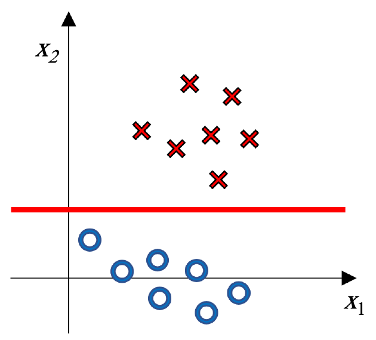

*原卷提供一条可调整红线；按题意自行移动或重画。 / The original supplies an adjustable red line.*

### 中文题意
(a) 将逻辑回归的L2正则换成L1，写出训练优化问题。

(b) 观察题图，画出最可能的L1正则逻辑回归边界，并解释。可以移动或调整图中给出的红线。

### English answer
(a) For labels $y_i\in\{-1,+1\}$, one consistent objective is

$$
(w^*,b^*)=\arg\min_{w,b}\left\{\frac1C\sum_j|w_j|+
\sum_i\log\!\left(1+e^{-y_i(w^Tx_i+b)}\right)\right\},\quad C>0.
$$

(b) Draw a horizontal line in the gap between the upper red crosses and lower blue circles, as the supplied red line does. The classes mainly differ in $x_2$, so a natural sparse solution keeps $x_2$ and sets $w_1=0$. Its boundary is $x_2=-b/w_2$ with $w_2\ne0$; the figure does not determine a unique height. L1 encourages exact zeros, but does not guarantee an axis-parallel boundary for every dataset or $C$.

### 中文对应答案
(a) 对标签$y_i\in\{-1,+1\}$，一种一致的目标函数写法是

$$
(w^*,b^*)=\arg\min_{w,b}\left\{\frac1C\sum_j|w_j|+
\sum_i\log\!\left(1+e^{-y_i(w^Tx_i+b)}\right)\right\},\quad C>0.
$$

(b) 在上方红叉与下方蓝圈之间的空隙画水平线，题图给出的红线就是这种画法。两类主要沿$x_2$方向分开，因此一个自然的稀疏解是保留$x_2$、令$w_1=0$。边界为$x_2=-b/w_2$，其中$w_2\ne0$；原图无法确定唯一高度。L1鼓励系数恰好为0，但不能保证在每个数据集或每个$C$下，边界都与坐标轴平行。

## MT001 · Logistic训练：哪些说法不成立？

**题型：** 选择题（多选） / Multiple select · 选不正确项 / Select incorrect statements

**考点：** 逻辑回归与参数正则

**出处：** 2020B期中Quiz Q1，原卷第2页（5分）

### English question
Which statements are not true about Logistic Regression? (select all that apply)

A) When training a Logistic Regression model, we have only one local optimum solution.

B) When training a Logistic Regression model, we should fix the learning rate (η) to obtain the local optimum.

C) When training a Logistic Regression model with L2-norm regularization, while increasing the hyperparameter C, the training error will increase and testing error will decrease.

D) When performing classification with Logistic Regression, we can use different decision function (e.g., sigmoid, sign) in training and testing process.

### 中文题意
关于逻辑回归，选择所有不正确的说法。

A）训练时只有一个局部最优解。B）必须固定学习率 $\eta$ 才能取得局部最优。C）使用L2正则时，增大C会使训练错误率上升、测试错误率下降。D）训练和测试可使用不同的决策函数，例如训练用sigmoid、测试用sign。

### English answer
The supplied key selects **B and C**. A fixed learning rate is not necessary; increasing C weakens the usual penalty and does not guarantee the stated changes in either error. Training may use sigmoid probabilities while prediction thresholds the score, making D valid. **A needs an additional qualification:** convexity rules out inferior local minima, but alone does not guarantee a unique finite minimizer.

### 中文对应答案
随卷答案选**B、C**。学习率不必固定；在常用约定下，增大C会减弱正则惩罚，但不能保证训练误差和测试误差一定按选项所说的方向变化。训练时可以使用sigmoid概率，预测时则对分数设阈值，因此D成立。**A还需要补充条件：** 凸性排除了比全局最优解更差的局部最小点，但仅凭凸性，不能保证存在唯一且有限的最小点。

## MT053 · LR与生成式模型：混合选择题

**题型：** 选择题（多选） / Multiple select

**考点：** 逻辑回归与参数正则

**出处：** 2023B期中 Q2，原卷第2页（5分）

### English question
Which statements are correct about the logistic regression? (select all that apply)

A) Logistic regression has a closed-form solution based on the MLE formulation, and thus it can be efficiently solved.

B) To prevent overfitting, we can add a prior distribution on its parameters using a Gaussian distribution.

C) Logistic regression is used for modelling the class posterior probability, which is different from generative classifiers that model the class-conditional distribution.

D) The regularization parameter of the logistic regression function can be selected via cross-validation.

E) L2 regularization is only used to stabilize the training, and it has no effects on the weights.

### 中文题意
关于逻辑回归，哪些说法正确？多选。A）MLE有闭式解，因此求解高效。B）为抑制过拟合，可给参数加高斯先验。C）LR建模类别后验，而生成式分类器建模类条件分布。D）可用交叉验证选正则化参数。E）L2只稳定训练，不影响权重。

### English answer
**B, C and D.** Logistic regression models $P(y\mid x)$ directly, whereas a generative classifier models $p(x\mid y)$ and $P(y)$ and derives $P(y\mid x)$ using Bayes' rule. Gaussian parameter priors correspond to L2 penalties in MAP training. Cross-validation can select their strength.

A is false for general logistic regression; numerical optimization is required. E is false because the penalty changes the optimized coefficients, typically shrinking their magnitudes.

### 中文对应答案
**B、C、D正确。** 逻辑回归直接建模$P(y\mid x)$；生成式分类器则先建模$p(x\mid y)$和$P(y)$，再通过Bayes规则推导$P(y\mid x)$。MAP训练中的高斯参数先验对应L2惩罚，可以通过交叉验证选择其强度。

A错误：一般的逻辑回归需要数值优化。E错误：惩罚项会改变优化得到的系数，通常会缩小它们的绝对值。

## MT042 · SVM的基本特点

**题型：** 选择题（多选） / Multiple select

**考点：** SVM与核方法

**出处：** 2023A期中 Q3，原卷第2页（5分）；2025A期中 Q3，原卷第2页（5分）

### English question
Which of the following are characteristics of Support Vector Machines (SVMs)? (select all that apply)

A) SVMs can work on non-separable data by adding slack variables.

B) SVMs find the hyperplane that maximizes the margin between classes.

C) SVMs are sensitive to outliers in the training data.

D) SVMs are unsuitable for high-dimensional data.

E) SVMs use k-means clustering to separate data.

### 中文题意
关于SVM，哪些说法成立？多选。

A）可通过松弛变量处理不可分数据。B）寻找最大间隔超平面。C）SVM对训练异常值敏感。D）SVM不适合高维数据。E）SVM用k-means聚类分开数据。

### English answer
The supplied 2023A key selects **A and B**. Slack variables allow violations, and margin maximization is central to the objective. D and E are false. C is context-dependent: hard-margin or heavily penalized soft-margin SVMs can be sensitive to outliers, whereas the degree of sensitivity depends on C, the kernel and contamination; the bare statement is too broad to treat as a universal characteristic.

### 中文对应答案
2023A随卷答案选**A、B**。松弛变量允许样本违反间隔约束，最大化间隔是SVM目标的核心。D、E错误。C是否成立取决于具体设置：硬间隔SVM或对违反约束惩罚很重的软间隔SVM，可能对异常值敏感；敏感程度取决于C、核以及数据受到异常值影响的情况，不能把这句话当作所有SVM的普遍特点。

## MT048 · 用一个例子讲清Kernel Trick

**题型：** 简答题 / Written response · 解释、举例

**考点：** SVM与核方法

**出处：** 2023A期中 Q9，原卷第6页（10分）

### English question
Explain the concept of the "kernel trick" in Support Vector Machines (SVMs) and provide an intuitive example (e.g., using a figure).

### 中文题意
解释SVM中的kernel trick，并给一个直观例子，可以画图。

### English answer
A feature map can make data linearly separable. The kernel trick replaces mapped inner products by k(x,z), without constructing the mapped vectors. For example, x=−1,+1 are positive and x=0 negative. Mapping Φ(x)=x² separates them at 0.5; its kernel is k(x,z)=x²z².

### 中文对应答案
特征映射可以让数据变得线性可分。核技巧用$k(x,z)$代替映射后向量的内积，无需实际构造这些向量。例如，$x=-1,+1$属于正类，$x=0$属于负类。映射$\Phi(x)=x^2$后，可以在0.5处设阈值分开两类；对应的核为$k(x,z)=x^2z^2$。

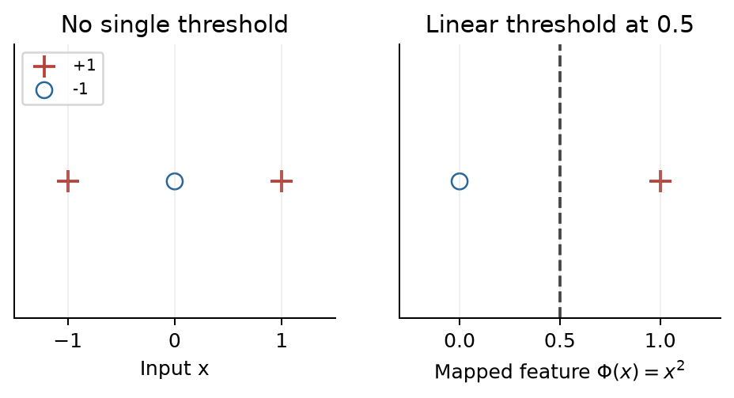

*答案示例图 / Answer example*

## MT016 · 核SVM：变换、存储与非向量输入

**题型：** 选择题（多选） / Multiple select

**考点：** SVM与核方法

**出处：** 2021A期中 Q3，原卷第2页（5分）

### English question
Which statements are true about kernel SVM? (select all that apply)

A) The kernel SVM is equivalent to learning a linear SVM on transformed inputs.

B) The training data is no longer necessary after learning the kernel SVM.

C) Any function that outputs positive values is a valid kernel function.

D) The kernel SVM can be applied to non-vector input data, like strings and sets.

E) The kernel trick can reduce both the memory and computation requirements, compared to an explicit transformation and inner-product.

### 中文题意
关于核SVM，哪些说法正确？多选。

A）等价于在变换后的输入上训练线性SVM。B）训练完成后不再需要训练数据。C）输出为正的任意函数都是合法核。D）可用于字符串、集合等非向量输入。E）相比显式变换再求内积，核技巧可能减少内存与计算。

### English answer
**A, D and E**, with E interpreted as possible savings in memory and computation relative to explicitly constructing the feature map and taking its inner products. Nonlinear kernel prediction normally retains support vectors and coefficients, so B is false. A valid real kernel must produce symmetric positive-semidefinite Gram matrices, not merely positive entries.

### 中文对应答案
**A、D、E正确**，其中E应理解为：相对于显式构造特征映射再求内积，核技巧有可能节省内存与计算。非线性核模型在预测时通常仍要保存支持向量及其系数，因此B错误。合法的实值核必须产生对称、半正定的Gram矩阵，不能仅要求各个元素为正。

## MT031 · RBF距离与带宽：看近点和远点

**题型：** 选择题（多选） / Multiple select

**考点：** SVM与核方法

**出处：** 2021B*期中 Q5，原卷第3页（5分）

### English question
Suppose we have the points x, y, and z below. We compute the Gaussian RBF kernel between the points, k(x,y) and k(x,z), using inverse bandwidth γ. Which statements are correct? (select all that apply)

A) For some choice of γ, both k(x,y) and k(x,z) will be close to 1.

B) For some choice of γ, both k(x,y) and k(x,z) will be close to 0.

C) For any choice of γ>0, $k(x,y)\ge k(x,z)$.

D) If k(x,y) is close to 1, then k(x,z) is also close to 1.

E) If k(x,y) is close to 0, then k(x,z) is also close to 0.

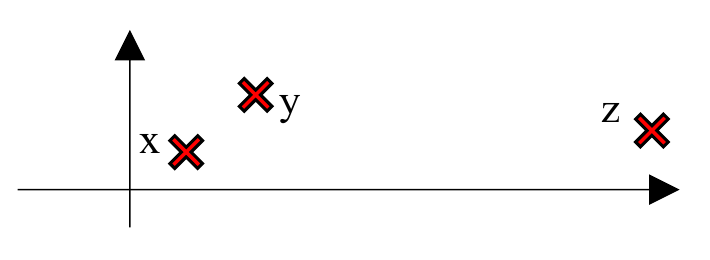

### 中文题意
题图中x离y较近、离z较远。用逆带宽γ计算Gaussian RBF核 $k(x,y)$ 和 $k(x,z)$，哪些说法正确？多选。

A）某些γ可使两者都接近1。B）某些γ可使两者都接近0。C）对任意γ>0都有 $k(x,y)\ge k(x,z)$。D）若前者接近1，后者也接近1。E）若前者接近0，后者也接近0。

### English answer
**A, B, C and E as printed.** For distinct points, both RBF similarities approach 1 as γ→0⁺ and 0 as γ→∞. The nearer point always has higher similarity, proving C and E. D fails: near similarity can be close to 1 while far similarity is not. The supplied key omits the true printed option C.

### 中文对应答案
**按印刷题面，A、B、C、E正确。** 对不同的点，当$\gamma\to0^+$时，两种RBF相似度都趋于1；当$\gamma\to\infty$时，都趋于0。近点的相似度始终高于远点，因此C、E成立。D不成立：近点的相似度可以接近1，而远点的相似度仍不接近1。随卷答案漏选了印刷题面中正确的C。

**原题差异 / Source note：** 配套答案列A、B、E；题纸的≥使C也成立，本解按题纸补C。 / The supplied key omits C, which is true as printed.

## MT055 · 判断五个候选核是否合法

**题型：** 选择题（多选） / Multiple select

**考点：** SVM与核方法

**出处：** 2023B期中 Q4，原卷第3页（5分）

### English question
Which of the following are valid positive semi-definite kernel functions? (select all that apply)

A) $k(x,z)=x^Tz/(\|x\|\|z\|)$.

B) $k(x,y)=\int p(x\mid z)p(y\mid z)p(z)\,dz$, where $p(x\mid z)$ and $p(y\mid z)$ are conditional distributions, and $p(z)$ is a marginal distribution.

C) $k(x,y)=1$ if $-1<x^Ty<1$, and 0 otherwise.

D) $k(x,y)=\sin(x^Ty)$.

E) $k(x,y)=\tanh(x^Ty)$.

### 中文题意
下面哪些函数是合法的半正定核？多选。各输入是实向量。

A）$k(x,z)=x^Tz/(\|x\|\|z\|)$。

B）$k(x,y)=\int p(x\mid z)p(y\mid z)p(z)\,dz$，前两项为条件分布，$p(z)$为边缘分布。

C）当 $-1<x^Ty<1$ 时 $k(x,y)=1$，否则为0。

D）$k(x,y)=\sin(x^Ty)$。

E）$k(x,y)=\tanh(x^Ty)$。

### English answer
**A and B**, on appropriate domains. A is the inner product of normalized nonzero inputs. For B, assuming the integrals exist, any coefficients aᵢ give

$$
\sum_{i,j}a_i a_j k(x_i,x_j)
=\int\left[\sum_i a_i p(x_i\mid z)\right]^2p(z)\,dz\ge0.
$$

C fails on one-dimensional inputs 0 and 2: its Gram matrix is [[1,1],[1,0]], with negative determinant. D can have a negative diagonal, e.g. x=√(3π/2). For E, inputs 1 and 2 and coefficients (1,−1) give tanh(1)+tanh(4)−2tanh(2)≈−0.1671<0. Thus C–E are not valid on all real inputs.

### 中文对应答案
**在适当的定义域上，A、B合法。** A是非零输入归一化之后的内积。对B，假设相关积分存在，则任意系数$a_i$都满足

$$
\sum_{i,j}a_i a_j k(x_i,x_j)
=\int\left[\sum_i a_i p(x_i\mid z)\right]^2p(z)\,dz\ge0.
$$

C有反例：取一维输入0和2，Gram矩阵为$\begin{pmatrix}1&1\\1&0\end{pmatrix}$，行列式为负。D的对角元素可能为负，例如取$x=\sqrt{3\pi/2}$。对E，取输入1、2及系数$(1,-1)$，得到$\tanh(1)+\tanh(4)-2\tanh(2)\approx-0.1671<0$。因此，C、D、E都不能在所有实数输入上作为合法核。

## MT060 · 二次核SVM：大C与小C的边界

**题型：** 简答题 / Written response · 作图、比较、解释

**考点：** SVM与核方法

**出处：** 2023B期中 Q9，原卷第6页（10分）

### English question
Consider the training data in the below figure, and the kernel SVM with quadratic polynomial kernel function. (a) Draw the decision boundary when C → ∞? (b) Draw the decision boundary for C → 0? (c) Which decision boundary would be better on the test data? For each part, give your reasons.

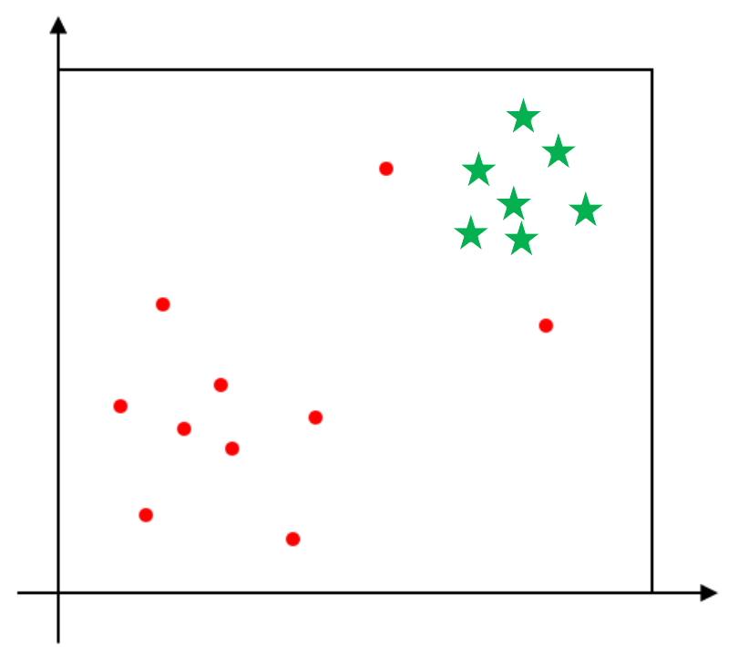

### 中文题意
给定题图训练点，使用二次多项式核SVM。(a) C趋于无穷时画边界。(b) C趋于0时画边界。(c) 哪个在测试数据上可能更好？每问说明理由。

### English answer
(a) A **large $C$** strongly penalizes margin violations. The supplied left-hand sketch bends the boundary to accommodate the isolated red points. Zero training error in this limit requires separability in the chosen quadratic feature space.

(b) For the **strict limit $C\to0^+$**, use the standard equally weighted soft-margin objective with an unpenalized bias. The figure has ten red and seven green points. Encode red as $-1$ and green as $+1$. The candidate $w=0,b=-1$ has objective $14C$, so the optimum satisfies $\|w_C\|^2\le28C$ and $w_C\to0$. Minimizing the remaining hinge loss selects $b_C\to-1$, the majority-class sign. Thus the plotted region is eventually classified entirely red, with no separating boundary inside it. The supplied right-hand curve illustrates a smaller positive $C$, not this strict limit.

(c) If the isolated points are noise, a moderate positive $C$ may generalize better than fitting them closely. This does not mean the all-red limit is best. A training diagram alone cannot determine test accuracy; choose $C$ using validation data.

### 中文对应答案
(a) **$C$较大**时，违反间隔约束的代价很高。随卷答案左图的边界会弯曲，以适应孤立的红点。这个极限能达到零训练误差，前提是数据在所选二次特征空间中可分。

(b) 对**严格的$C\to0^+$极限**，采用各样本权重相同、偏置不受正则惩罚的标准软间隔目标。原图有10个红点、7个绿点。令红类为$-1$、绿类为$+1$，候选解$w=0,b=-1$的目标值为$14C$，因此最优解满足$\|w_C\|^2\le28C$，权重趋于0。继续使hinge损失最小，会让$b_C\to-1$，即多数类的符号。因此，图示区域最终全部判为红类，区域内不再有分隔边界。随卷右图表示较小的正$C$，不是这个严格极限。

(c) 如果这些孤立点是噪声，取适中的正$C$可能比努力拟合它们更容易推广到新数据，但不能因此说全判红类的极限最好。仅凭训练图无法确定测试准确率，应在验证数据上选择$C$。

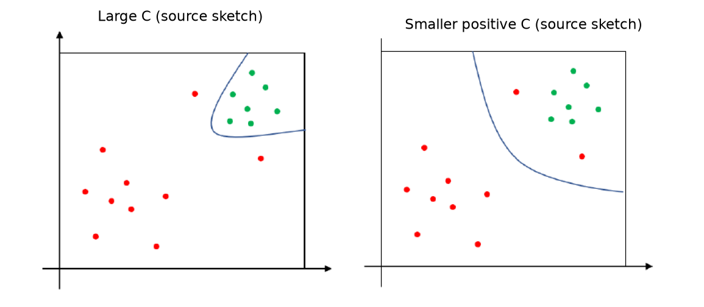

*随卷答案草图：右图表示较小正$C$，不表示严格$C\to0^+$。 / Supplied sketches: the right plot represents a smaller positive $C$, not the strict $C\to0^+$ limit.*

**原题差异 / Source note：** 原解把较小正C的分隔曲线用于C趋零；按本题标准目标，严格极限全判多数红类。 / The supplied small-positive-C sketch is not the strict limit, which predicts the majority red class under the stated standard objective.

## MT054 · C、支持向量与RBF的零训练误差

**题型：** 选择题（多选） / Multiple select

**考点：** SVM与核方法

**出处：** 2023B期中 Q3，原卷第2页（5分）

### English question
Which statements about support vector machines (SVMs) are correct? (select all that apply)

A) If the hyperparameter C is set to infinity, all the training points will be classified correctly if they are linearly separable.

B) Assuming there are three support vectors, the boundary will not change when one of the support vectors is moved.

C) If an SVM underfits the training data, then mapping the data to a lower-dimensional feature space will improve the classification performance.

D) The basic form of SVM is a convex quadratic programming problem.

E) The training data can always be correctly classified with a kernel SVM with RBF kernel function.

### 中文题意
关于SVM，哪些说法正确？多选。

A）线性可分时，C设为无穷可使训练点全部分类正确。B）三个支持向量之一移动，边界不会改变。C）欠拟合时，映射到更低维空间会改善表现。D）基本SVM是凸二次规划。E）RBF核SVM总能把训练数据完全分类正确。

### English answer
The supplied key is **A, D and E**, but **E requires qualification**. For distinct finite inputs, an RBF kernel with positive bandwidth parameter permits interpolation in its feature space, and sufficiently strong fitting can achieve zero training error. Duplicate inputs with conflicting labels cannot be separated by any deterministic classifier, and an arbitrary finite C need not fit all labels. A refers to the separable hard-margin limit; B and C have no such guarantee.

### 中文对应答案
随卷答案为**A、D、E**，但**E需要加条件**。对于有限个互不相同的输入，带宽参数为正的RBF核允许在特征空间中插值；足够强地拟合数据时，可以达到零训练误差。若相同输入对应相互冲突的标签，任何确定性分类器都不能把它们分开；任意给定的有限C也不保证能拟合所有标签。A指可分数据的硬间隔极限；B、C没有相应保证。

## MT043 · 核SVM怎样处理非线性？

**题型：** 选择题（多选） / Multiple select

**考点：** SVM与核方法

**出处：** 2023A期中 Q4，原卷第3页（5分）；2025A期中 Q4，原卷第2页（5分）

*题头差异：2023A含“kernel”，2025A省略该词；以下采用2023A题头，两卷选项相同。 / The 2023A heading is used below; the 2025A heading omits “kernel”. The options are identical.*

### English question
Which statements about kernel support vector machines (SVMs) are correct? (select all that apply)

A) Support Vector Machines (SVM) can directly handle non-linearly separable data.

B) Radial basis functions are a commonly used type of kernel function.

C) Kernel methods can transform non-linear problem into a more efficient problem in the feature space.

D) The dual problem for SVM mainly involves selecting support vectors.

E) Using kernels can reduce the memory and computation requirements via explicit feature transformation and inner product calculations.

### 中文题意
关于核SVM，哪些说法成立？多选。

A）SVM可以直接处理线性不可分的数据。B）径向基函数是常用核。C）核方法把非线性问题变成特征空间里更高效的问题。D）SVM对偶问题主要涉及选择支持向量。E）通过显式特征变换和内积，核可以降低内存与计算。

### English answer
The supplied key is **B and D**. Interpret D as optimizing sample multipliers, whose nonzero values identify support vectors—not selecting them in advance. A is ambiguous under the kernel-SVM heading: nonlinear kernels can model nonlinear boundaries, whereas soft-margin tolerance alone does not make a linear SVM nonlinear. The supplied key nevertheless omits A. A feature-space reformulation does not automatically guarantee efficiency. The kernel trick avoids explicit feature construction, contrary to E's wording.

### 中文对应答案
随卷答案为**B、D**。D应理解为优化各样本的乘子，其中非零乘子对应支持向量，而不是提前选出支持向量。A放在“核SVM”题目下有歧义：非线性核能产生非线性边界，但仅靠软间隔允许违反约束，并不能让线性SVM变成非线性模型；随卷答案仍未选A。改写到特征空间并不自动保证计算更高效。核技巧避免显式构造特征，这与E的表述相反。

## MT029 · 哪些SVM说法错误？

**题型：** 选择题（多选） / Multiple select · 选不正确项 / Select incorrect statements

**考点：** SVM与核方法

**出处：** 2021B*期中 Q3，原卷第2页（5分）

### English question
Which statements about support vector machines are NOT correct? (select all that apply)

A) Kernel SVM cannot handle linearly separable data.

B) Data points lying around the regression tube boundary in support vector regression are called support vectors.

C) Kernel SVM can be interpreted as learning a linear classifier in a high-dimensional space.

D) The kernel function is limited to vector data only.

E) Because SVM only needs support vectors to estimate model parameters, it has good scalability to large datasets.

### 中文题意
关于SVM，选择所有不正确的说法。

A）核SVM不能处理线性可分数据。B）SVR中回归容忍带边界附近的点称为支持向量。C）核SVM可理解成在高维空间中学习线性分类器。D）核函数只能用于向量输入。E）SVM只需要支持向量估计模型参数，所以对大数据扩展性很好。

### English answer
**A, D and E** are the intended incorrect statements. Kernel models can also fit linearly separable data, and valid kernels can be defined on strings or sets. Support vectors are identified during fitting; training does not start by knowing which examples can be discarded. B is an informal description: nonzero dual coefficients define predictive support, and points outside the SVR tube can also be support vectors.

### 中文对应答案
本题预期的错误选项为**A、D、E**。核模型也可以拟合线性可分数据，合法核也可以定义在字符串或集合上。支持向量是在拟合过程中确定的，训练开始时并不知道哪些样本可以丢弃。B只是概括说法：预测中起作用的是非零对偶系数对应的样本，SVR容忍管道之外的点也可能是支持向量。

## MT010 · 同一张分布图，Gaussian Bayes与二次核SVM如何判断？

**题型：** 简答题 / Written response · 读图或公式、比较

**考点：** SVM与核方法

**出处：** 2020B期中Quiz Q10，原卷第5页（10分）

### English question
Consider the data distribution shown in the figure below. If you train a Bayes Gaussian classifier, which class will be predicted for data point D? If we change the classifier to an SVM with polynomial kernel of degree 2, which class will be predicted? Explain why.

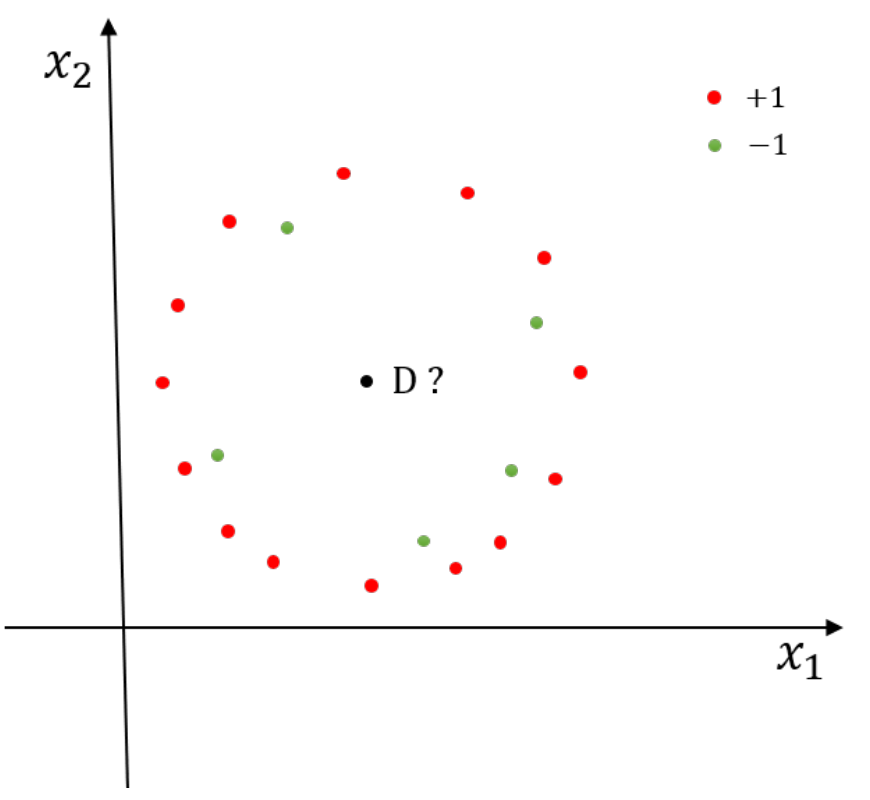

### 中文题意
依据题图的两类训练数据，Gaussian Bayes分类器会将点D判为哪一类？换成二次多项式核SVM后呢？分别解释。红点为+1，绿点为−1。

### English answer
The supplied solution expects **+1 for Gaussian Bayes and −1 for quadratic-kernel SVM**. Bayes compares $p(D\mid c)P(c)$. The more numerous red points give a larger estimated red-class prior, which can offset a density disadvantage at D; the supplied schematic fit favours red. It is not simply a nearest-centre decision. The quadratic SVM can enclose the inner green points with a curved boundary, placing D on their negative side.

These are the intended schematic results: exact Gaussian parameters and SVM $C$ are not supplied, so the plot does not uniquely determine a numerical fit.

### 中文对应答案
随卷解答预期：**Gaussian Bayes判为+1，二次核SVM判为−1。** Bayes比较$p(D\mid c)P(c)$。红点更多，会使估计的红类先验更大，可能抵消D处类条件密度较低的影响；随卷示意拟合最终倾向红类。它不是简单地选择最近的类别中心。二次核SVM可以用曲线包围内部绿点，把D也放在绿色负类一侧。

这些是示意图所表达的判断。题目没有给出确切的高斯参数和SVM的$C$，因此不能从图中唯一确定一个数值拟合结果。

## MT009 · 十万维特征、两千样本：SVM怎样提速？

**题型：** 简答题 / Written response · 提出办法、解释

**考点：** SVM与核方法

**出处：** 2020B期中Quiz Q9，原卷第4页（10分）

### English question
Your friend is training a linear SVM on a patient data from a hospital. There are 2000 patients, and each patient has 100,000 features extracted from their time in the hospital. Your friend complains that training the linear SVM takes too long. What suggestions do you give your friend to speed up the training?

### 中文题意
医院数据有2000名患者，每人100,000维特征。朋友训练线性SVM很慢，你建议怎样提速？说明理由。

### English answer
Compare primal and dual formulations and use a solver suited to the data. The primal has about 100,000 weights plus a bias; the dual has 2,000 sample multipliers and a 2,000×2,000 Gram matrix. A dual method may therefore be attractive when d≫N. Also exploit sparse inputs and efficient linear-SVM implementations; validated feature reduction is another option. Variable counts alone do not guarantee a wall-clock speedup.

### 中文对应答案
比较原始形式和对偶形式，选择适合数据的求解器。原始形式约有100,000个权重和一个偏置；对偶形式有2,000个样本乘子，以及一个$2000\times2000$的Gram矩阵。因此，当$d\gg N$时，对偶方法可能更合适。还可利用输入的稀疏性和高效的线性SVM实现，或尝试经验证有效的特征降维。仅比较变量数量，不能保证实际运行时间一定缩短。

## MT061 · 预测内存：线性SVM与RBF SVM

**题型：** 简答题 / Written response · 排序、解释

**考点：** SVM与核方法

**出处：** 2023B期中 Q10，原卷第7页（10分）

### English question
Consider a binary classification problem where the input feature space is d=1,000 dimensions, and we have 2,000 training samples. Rank the following classifiers based on their memory usage (from lowest to highest) when implementing their respective prediction functions: linear SVM with C=0.1, linear SVM with C=1000, RBF kernel SVM with C=0.1, RBF kernel SVM with C=1000. Explain the reasons for your rankings.

### 中文题意
二分类输入1000维、训练样本2000条。按预测函数的内存从小到大排列：线性SVM(C=0.1)、线性SVM(C=1000)、RBF SVM(C=0.1)、RBF SVM(C=1000)。解释排序。

### English answer
The two linear models tie under the standard compressed representation: d weights plus one bias, **1001 numbers**, independent of C. A kernel model with M support vectors stores approximately M(d+1)+1 numbers (support-vector coordinates, one coefficient each, and a bias).

Under this representation, the ranking is linear(C=0.1) = linear(C=1000) < ordinary nondegenerate RBF models. The two RBF models cannot be universally ordered from C alone; their actual support-vector counts are needed. The supplied answer puts C=1000 before C=0.1 based on a presumed decrease in M, but support-vector count is not generally monotone in C.

### 中文对应答案
按标准的压缩存储方式，两个线性模型并列：都只需保存$d$个权重和一个偏置，共**1001个数**，与C无关。具有M个支持向量的核模型约需保存$M(d+1)+1$个数，包括支持向量坐标、每个支持向量的一个系数，以及一个偏置。

在这种表示下，内存占用排序为：线性（C=0.1）=线性（C=1000）<通常的非退化RBF模型。两个RBF模型不能仅凭C确定先后，还要知道实际支持向量数量。原解把C=1000排在C=0.1之前，依据是支持向量数量M会减少的假设；但M一般不随C单调变化。

## MT019 · Ridge、LASSO与零系数

**题型：** 选择题（多选） / Multiple select

**考点：** 回归、特征选择与残差损失

**出处：** 2021A期中 Q6，原卷第3页（5分）

### English question
Which statements about linear regression are correct? (select all that apply)

A) Overfitting is more likely when you have large amount of training data.

B) Some of the weight coefficients will approach zero, but not absolutely zero, when applying very large penalty α in LASSO regression.

C) LASSO can be used for feature selection.

D) Some of the weight coefficients will approach zero, but not absolute zero, when applying very large penalty α in Ridge Regression.

E) OLS is a special case of both LASSO and Ridge regression.

### 中文题意
关于线性回归，哪些说法正确？多选。

A）训练数据越多越容易过拟合。B）LASSO的惩罚α很大时，某些系数只接近零而不会恰为零。C）LASSO可用于特征选择。D）Ridge的惩罚α很大时，某些系数会接近零，但不会恰好为零。E）OLS是LASSO和Ridge的特殊情形。

### English answer
**C, D and E** under the usual interpretation. LASSO can produce exact zeros; ridge generally shrinks coefficients continuously. Setting the penalty to zero recovers the OLS objective. A is not a general relationship. D describes typical ridge behaviour, not a theorem that a ridge coefficient can never equal zero.

### 中文对应答案
**按通常的理解，C、D、E正确。** LASSO能使部分系数恰好为0；ridge通常连续地缩小系数。把惩罚强度设为0，就恢复普通最小二乘（OLS）的目标。A不是一般成立的关系。D描述的是ridge的典型行为，并不是说ridge系数在任何情况下都不可能为0。

## MT045 · 特征选择：零系数、Ridge与OMP

**题型：** 选择题（多选） / Multiple select

**考点：** 回归、特征选择与残差损失

**出处：** 2023A期中 Q6，原卷第3页（5分）

### English question
Which of the following statements is correct about linear regression and feature selection? (select all that apply)?

A) Feature selection can be achieved by encouraging some linear weights to go to zero.

B) Ridge regression is effective for feature selection because it uses L2 norm to regularize the weights.

C) Orthogonal matching pursuit (OMP) can find the global optimal set of features for a given sparsity level.

D) The same set of features will always give the same set of linear weights, regardless of the features selection method used with linear regression.

E) L1 regularization is good at encouraging sparse weights because of the “corners” in its contours.

### 中文题意
关于线性回归和特征选择，哪些说法正确？多选。

A）鼓励部分权重为零可做特征选择。B）Ridge因使用L2而能有效自动选择特征。C）OMP能找到给定稀疏度下的全局最优特征集合。D）只要特征集合相同，无论选择方法如何都会得到同一组系数。E）L1等高线的尖角有利于产生稀疏权重。

### English answer
**A and E.** A zero coefficient removes that feature's direct contribution; L1 geometry promotes such solutions. Ridge usually shrinks rather than exactly eliminates coefficients. OMP is greedy, not a general solver for the globally best subset. Different penalties/objectives can yield different weights even with the same feature list.

### 中文对应答案
**A、E正确。** 某个特征的系数为0，就去掉了它对预测的直接贡献；L1约束的几何形状有利于出现这类解。Ridge通常缩小系数，而不是让系数恰好为0。OMP采用贪心选择，不能一般性地求出全局最优的特征子集。即使使用相同的特征列表，不同的惩罚或目标函数也可能得到不同的权重。

## MT030 · L1/L2回归的益处与措辞边界

**题型：** 选择题（多选） / Multiple select

**考点：** 回归、特征选择与残差损失

**出处：** 2021B*期中 Q4，原卷第2页（5分）

### English question
What are the benefits of adding regularization terms (L1 or L2) to a linear regression model? (select all that apply)

A) Both L1 and L2 can make the regression model easier to optimize.

B) Both L1 and L2 can make the matrix inversion well-conditioned.

C) Both L1 and L2 make the regression model more robust to outliers.

D) Adding L1 or L2 term can encourage some weights to be close to zero so as to select features.

E) Both L1 and L2 can penalize the training loss of the regression model and prevent overfitting.

### 中文题意
给线性回归加L1或L2正则，哪些说法成立？多选。

A）两者都能让优化更容易。B）两者都能使矩阵求逆更良态。C）两者都使模型更抗异常值。D）两者可使某些权重接近零，从而选择特征。E）两者都可以为模型增加惩罚、抑制过拟合。

### English answer
The supplied key selects **D and E**. Read D carefully: both can shrink coefficients, but **automatic exact-zero selection is characteristic of L1**, not ordinary ridge. E describes a possible generalization benefit, not a guarantee. L2 can improve a least-squares system's conditioning; L1 is nonsmooth and does not provide the same inverse-matrix argument. Weight regularization alone is not a robust residual loss.

### 中文对应答案
随卷答案选**D、E**。D需要谨慎理解：两者都能缩小系数，但**自动产生恰好为0的系数是L1的特点**，并非普通ridge的特点。E说的是可能改善泛化，并不保证一定改善。L2可以改善最小二乘系统的条件数，使求解更稳定；L1不光滑，不能套用同样的矩阵求逆论证。仅对权重加正则，并不等于采用了对异常残差稳健的损失。

## MT057 · 同时使用L1与L2：Elastic Net

**题型：** 选择题（多选） / Multiple select

**考点：** 回归、特征选择与残差损失

**出处：** 2023B期中 Q6，原卷第3页（5分）；2025A期中 Q6，原卷第3页（5分）

### English question
Considering linear regression using both L1 and L2 as regularization terms:

$$
\min_{w,b}\left\{\alpha\|w\|_1+\beta\|w\|_2^2+
\sum_{i=1}^N[y_i-f(x_i)]^2\right\}.
$$

Which properties does it have? (select all that apply)

A) It treats all weights equally.

B) The penalty term focuses more on reducing large weights.

C) It has a closed-form solution.

D) It can perform feature selection and shrinkage simultaneously.

E) The elements of w are always positive.

### 中文题意
线性回归采用

$$
\min_{w,b}\left\{\alpha\|w\|_1+\beta\|w\|_2^2+
\sum_{i=1}^N[y_i-f(x_i)]^2\right\}.
$$

它有哪些性质？多选。A）对所有权重一视同仁。B）惩罚更侧重压低大权重。C）存在闭式解。D）可同时做特征选择与收缩。E）w各元素总为正。

### English answer
**B and D in the supplied key.** L1 encourages exact zeros; L2 shrinks large weights. General Elastic Net requires numerical optimization, though special cases have explicit solutions. The same α and β are applied to every weight, but different weight magnitudes incur different penalties. Negative weights are allowed.

### 中文对应答案
**随卷答案选B、D。** L1鼓励系数恰好为0，L2抑制大权重。一般的Elastic Net需要数值优化，但特殊情形可以有显式解。各个权重都使用相同的α和β，但大小不同的权重受到的惩罚不同。权重可以为负。

## MT025 · 绝对残差损失对异常值有什么影响？

**题型：** 简答题 / Written response · 解释

**考点：** 回归、特征选择与残差损失

**出处：** 2021A期中 Q12，原卷第4页（10分）

### English question
Consider a linear regression function $f(x)=w^Tx+b$, which is trained on the data $(x_i,y_i)$, i=1,…,N, using the following optimization problem, where the absolute prediction error is the loss function:

$$
(\hat w,\hat b)=\arg\min_{w,b}\sum_{i=1}^N|f(x_i)-y_i|.
$$

What will be the effect of using this loss during training? Why?

### 中文题意
考虑线性回归函数$f(x)=w^Tx+b$，在数据$(x_i,y_i)$、$i=1,\ldots,N$上训练，以预测误差的绝对值作为损失：

$$
(\hat w,\hat b)=\arg\min_{w,b}\sum_{i=1}^N|f(x_i)-y_i|.
$$

使用这种损失会怎样影响训练？为什么？

### English answer
Absolute-error loss grows linearly instead of quadratically, so very large output residuals have less relative influence than under least squares. Its residual derivative has constant magnitude away from zero, making it more robust to large y-outliers. This is a change to the data loss, not an L1 penalty on the weights, and it does not imply sparse coefficients.

### 中文对应答案
绝对误差损失随残差线性增长，而不是平方增长，因此相对于最小二乘，特别大的输出残差影响较小。除残差为0的位置外，它对残差的导数绝对值恒定，所以对输出$y$中的大异常值更稳健。这里改变的是数据损失，并不是给权重加L1惩罚，也不意味着会得到稀疏系数。

## MT063 · Huber损失：画图并解释好处

**题型：** 简答题 / Written response · 作图、解释

**考点：** 回归、特征选择与残差损失

**出处：** 2023B期中 Q12，原卷第9页（10分）

### English question
Consider linear regression using the Huber loss function:

$$
L(f(x_i),y_i)=
\begin{cases}
\frac12[y_i-f(x_i)]^2,&|y_i-f(x_i)|<1,\\
|y_i-f(x_i)|-\frac12,&\text{otherwise}.
\end{cases}
$$

(a) Draw a plot of the loss function.

(b) Explain one benefit of using Huber loss for linear regression.

### 中文题意
令残差 $r=y_i-f(x_i)$，线性回归使用

$$
L(r)=\begin{cases}\frac12r^2,&|r|<1,\\|r|-\frac12,&\text{otherwise}.\end{cases}
$$

(a) 画出损失函数。(b) 解释使用Huber损失的一个好处。

### English answer
Draw a parabola between −1 and 1, joined smoothly to straight tails: L(0)=0, L(±1)=1/2 and L(±2)=3/2. Its residual derivative is r inside the interval and sign(r) outside. Thus extreme output residuals have bounded gradient magnitude, reducing their influence relative to squared loss. Unlike pure absolute loss, the curve is differentiable at zero and at the two joining points.

### 中文对应答案
在−1到1之间画一段抛物线，两端平滑连接直线：$L(0)=0$，$L(\pm1)=1/2$，$L(\pm2)=3/2$。损失对残差的导数，在区间内为$r$，在区间外为$\operatorname{sign}(r)$。因此，极大输出残差产生的梯度绝对值有上界，相比平方损失，其影响受到限制。与纯绝对值损失不同，Huber曲线在0及两处连接点都可导。

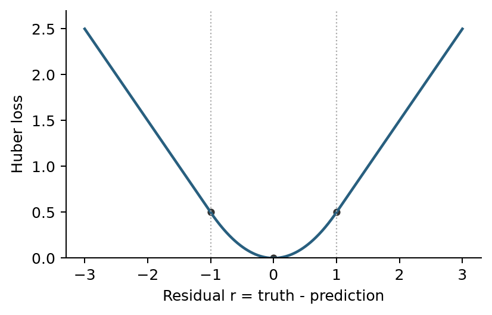

*按题干公式作图 / Plot of the given formula*

**原题差异 / Source note：** 随卷答案图高度为题干公式的两倍；本图按公式，L(±1)=0.5。 / The supplied plot is scaled by two; this plot follows the formula.

## MT013 · 残差L1＋权重L2，各自在做什么？

**题型：** 简答题 / Written response · 解释

**考点：** 回归、特征选择与残差损失

**出处：** 2020B期中Quiz Q13，原卷第6页（10分）

### English question
Your friend has designed a new regression algorithm that minimizes the L1 norm of the error and L2 norm of the weights, given by the following optimization problem:

$$
w^*=\arg\min_w\left\{\sum_{i=1}^N|w^Tx_i-y_i|+\lambda\|w\|_2^2\right\}.
$$

What properties would you expect this regression algorithm to have? Explain why.

### 中文题意
某回归方法同时最小化残差的L1范数与权重的L2平方：

$$
w^*=\arg\min_w\left\{\sum_{i=1}^N|w^Tx_i-y_i|+\lambda\|w\|_2^2\right\}.
$$

预期它有什么性质？解释原因。

### English answer
Absolute residual loss grows linearly, so large output errors have less influence than under squared loss. L2 regularization discourages large coefficients and can stabilize fitting. It normally shrinks weights rather than producing the exact sparsity associated with L1 weight penalties. The loss is convex but nonsmooth at zero residual; suitable regularization can improve generalization, without guaranteeing it.

### 中文对应答案
绝对残差损失线性增长，因此大输出误差的影响比平方损失下小。L2正则化抑制大系数，可以使拟合更稳定；它通常缩小权重，而不是像L1权重惩罚那样产生恰好为0的稀疏系数。该损失是凸的，但在残差为0处不光滑。合适的正则化可能改善泛化，但不能保证一定改善。

## MT050 · 缺车比车多更糟：设计非对称损失

**题型：** 简答题 / Written response · 设计、作图、解释

**考点：** 回归、特征选择与残差损失

**出处：** 2023A期中 Q12，原卷第9页（10分）；2025A期中 Q12，原卷第9页（10分）

### English question
You are working for a bike-sharing company, and your job is to predict the number of bicycles that will be borrowed from a popular bike-sharing station each day. This prediction will be used to inform the logistics team about how many bikes should be sent to the station. The CEO tells you that it is okay to have too many bikes sent to the station, but it is not good if the station runs out of bikes, since the customers will use other bike-sharing companies.

You have a training dataset $(x_i,y_i)$, i=1,…,N, of historical data that contains feature vectors $x_i$, and number of bikes borrowed $y_i$. Consider a linear regression function $f(x)=w^Tx+b$, which is trained with the following optimization problem:

$$
(\hat w,\hat b)=\arg\min_{w,b}\sum_{i=1}^N L(f(x_i),y_i).
$$

Design a loss function that can help you to do the regression according to the requirements, and draw a plot. Explain how your loss achieves the desired requirements.

### 中文题意
你在一家共享单车公司工作，需要预测一个热门站点每天的借车量，供调度团队决定向该站点运送多少辆车。公司认为多送一些车可以接受，但缺车会让顾客转用其他公司的单车。

已有历史训练数据$(x_i,y_i)$、$i=1,\ldots,N$，其中$x_i$是特征向量，$y_i$是借车量。线性回归函数$f(x)=w^Tx+b$通过下式训练：

$$
(\hat w,\hat b)=\arg\min_{w,b}\sum_{i=1}^N L(f(x_i),y_i).
$$

设计一个符合上述要求的损失函数，并画图。解释该损失怎样实现公司的要求。

### English answer
Define $r=f(x)-y$. Use $L(r)=c_-r^2$ for $r<0$ and $L(r)=c_+r^2$ otherwise, with $c_->c_+>0$. Draw two parabolic halves meeting at zero, the negative-residual side steeper. Equal-sized shortages then cost more than surpluses.

### 中文对应答案
定义残差$r=f(x)-y$。当$r<0$时用$L(r)=c_-r^2$，否则用$L(r)=c_+r^2$，其中$c_->c_+>0$。画出两段在0处相接的抛物线，负残差一侧更陡。这样，同样数量的缺车会比车过剩受到更大的惩罚。

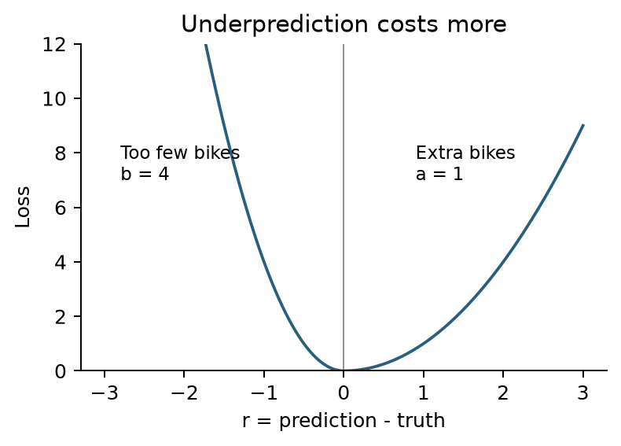

*作图示例：图中 $b=c_-=4$、$a=c_+=1$。 / Example plot with $b=c_-=4$ and $a=c_+=1$.*

## MT037 · 线性回归为何与均值预测器表现相近？

**题型：** 简答题 / Written response · 提出办法、解释

**考点：** 回归、特征选择与残差损失

**出处：** 2021B*期中 Q11，原卷第4页（10分）

### English question
Your friend wants to predict the number of taxis used in HK in one hour from various features, such as weather, time of day, day of year, etc. Your friend uses linear regression to fit the data, but finds that the mean squared error (MSE) on the validation set is about the same as a “dummy” regressor that just predicts the mean of the training data. What two pieces of advice would you give to your friend to improve their regressor? Explain why.

### 中文题意
你的朋友想用天气、一天中的时段、一年中的日期等特征，预测香港一小时内的出租车使用量。他用线性回归拟合数据，却发现模型在验证集上的均方误差（MSE），与一个始终预测训练数据平均值的“基线”回归器相近。你会提出哪两个改进建议？分别说明原因。

### English answer
Two useful directions are (1) add informative features or interactions, such as time-of-day effects interacting with weather, so the model can learn demand changes that the current features miss; and (2) use a nonlinear representation/model if the relationship is not linear, because an additive linear rule cannot represent curved or threshold-like demand patterns. Compare by validation or training-only CV. Also check excessive regularization, data alignment and optimization. The validation result alone does not prove the training least-squares solution is wrong.

### 中文对应答案
两个值得尝试的方向是：（1）加入有用的特征或交互项，例如一天中的时段与天气之间的交互，让模型学到现有特征遗漏的需求变化；（2）若输入与输出的关系不是线性的，就采用非线性表示或模型，因为简单线性相加无法表示弯曲或带阈值的需求变化。通过验证集或训练数据内部的交叉验证比较效果。同时检查正则化是否过强、数据是否正确对齐，以及优化是否正常。仅凭验证结果，不能认定训练得到的最小二乘解有错。

## MT006 · Bagging与Boosting的基本区别

**题型：** 选择题（多选） / Multiple select

**考点：** 集成学习

**出处：** 2020B期中Quiz Q6，原卷第3页（5分）

### English question
Which statements are true about bagging and boosting? (select all that apply)

A) Bagging and boosting are both ensemble methods.

B) Bagging is based on iteratively building classifiers, while boosting makes the classifiers faster.

C) Bagging and boosting are only based on decision trees or decision stumps.

D) Bagging and boosting both overfit when adding too many classifiers.

E) Bagging and boosting can be combined together.

### 中文题意
关于bagging和boosting，哪些说法正确？多选。

A）二者都是集成方法。B）bagging是迭代建分类器，boosting的作用是让分类器更快。C）二者只能使用树或树桩。D）二者都会因为增加太多分类器而过拟合。E）二者可以组合。

### English answer
**A and E.** Bagging aggregates learners fitted to resampled data; boosting builds learners sequentially to address the current ensemble's errors or weighted loss. Neither is restricted in principle to trees. More learners do not universally cause overfitting, and boosting does not mean computational acceleration.

### 中文对应答案
**A、E正确。** Bagging汇总在重采样数据上训练出的多个模型；boosting则依次训练模型，针对当前集成的错误或加权损失进行改进。两者原则上都不限于使用决策树。模型数量增加不一定导致过拟合，boosting也不表示计算加速。

## MT044 · 随机森林与Boosting的用途

**题型：** 选择题（多选） / Multiple select

**考点：** 集成学习

**出处：** 2023A期中 Q5，原卷第3页（5分）；2025A期中 Q5，原卷第3页（5分）

### English question
Which of the following is/are true about Random Forest and Boosting ensemble methods? (select all that apply)

A) An individual tree in the random forest is built on a subset of the features.

B) Random forests use learning rate as of one of its hyperparameters.

C) Both methods can be used for the regression task.

D) Random Forest is only used for regression whereas gradient boosting is only used for classification.

E) None of the above.

### 中文题意
关于随机森林与boosting，哪些说法正确？多选。

A）随机森林的单棵树基于部分特征建立。B）随机森林有学习率超参数。C）两者都可用于回归。D）RF只用于回归，gradient boosting只用于分类。E）以上均不对。

### English answer
The course key selects **A and C**. Random forests use randomized feature candidates in their usual construction, and both ensemble families support regression as well as classification. Ordinary random forests do not use the boosting learning-rate parameter. A should not be read as requiring one permanently fixed feature subset for every split of a tree; feature sampling is commonly performed at each node.

### 中文对应答案
课程答案选**A、C**。随机森林的通常构造会随机选取候选特征；两类集成方法都可以用于回归和分类。普通随机森林不使用boosting中的学习率参数。A不能理解为一棵树的所有分裂都必须使用同一个固定特征子集；常见做法是在每个节点重新抽取候选特征。

## MT062 · 随机森林：树多了为什么仍有共同误差？

**题型：** 简答题 / Written response · 读图或公式、提出办法

**考点：** 集成学习

**出处：** 2023B期中 Q11，原卷第8页（10分）

### English question
For a random forest F of n trees, suppose the variance of the error of a decision tree f is $\sigma^2$, and the correlation coefficient between the errors of two trees is ρ. We will have the error variance of F as:

$$
\operatorname{var}(F)=\operatorname{var}\left(\frac1n\sum_{i=1}^nf_i\right)
=\frac{\sigma^2}{n}+\frac{n-1}{n}\rho\sigma^2.
$$

(a) Explain the relationship between the number of trees and the correlation coefficient and the ability of F to reduce overfitting.

(b) For a fixed number of trees n, explain some concrete methods to reduce the error variance of F.

### 中文题意
随机森林$F$由$n$棵树组成。单棵决策树$f$的误差方差为$\sigma^2$，两棵不同树的误差相关系数为$\rho$。森林取各树预测的平均，其误差方差为

$$
\operatorname{Var}(F)=\operatorname{Var}\left(\frac1n\sum_{i=1}^nf_i\right)
=\frac{\sigma^2}{n}+\frac{n-1}{n}\rho\sigma^2.
$$

(a) 解释树的数量、误差相关系数与森林减少过拟合能力的关系。

(b) 固定树的数量$n$时，说明几种降低森林误差方差的具体方法。

### English answer
(a) Rewrite the variance as $\sigma^2[\rho+(1-\rho)/n]$. For fixed tree variance and fixed $0\le\rho\le1$, more trees reduce the second term; as $n\to\infty$, the variance approaches $\rho\sigma^2$. If $\rho=0$, it is $\sigma^2/n$; if $\rho=1$, adding trees gives no reduction. Lower correlation therefore makes averaging more effective at reducing the variance component of overfitting.

(b) At fixed $n$, train trees on different bootstrap samples and randomly choose feature candidates at each split. These changes reduce shared tree errors, while each tree should retain predictive strength. Lower variance alone does not guarantee lower total test error.

### 中文对应答案
(a) 将方差改写为$\sigma^2[\rho+(1-\rho)/n]$。固定单树方差和$0\le\rho\le1$时，增加树的数量会减小第二项；当$n\to\infty$时，方差趋于$\rho\sigma^2$。若$\rho=0$，方差为$\sigma^2/n$；若$\rho=1$，再加树也不能降低方差。因此，树之间的相关性越低，平均预测越能减轻与方差有关的过拟合。

(b) 固定$n$时，用不同的bootstrap样本训练各树，并在每次分裂时随机选择候选特征。这样可以减少各树共同犯的错误，同时应保留各棵树的预测能力。仅降低方差，不保证总测试误差一定降低。

## MT056 · 集成方法：树深、并行与后续轮次

**题型：** 选择题（多选） / Multiple select

**考点：** 集成学习

**出处：** 2023B期中 Q5，原卷第3页（5分）

### English question
Which statements are true about ensemble methods? (select all that apply)

A) Using fewer decision trees with higher depth is better than using more “stumps” for weak learners in Adaboost.

B) Using linear classifiers like logistic regression for bagging is a good choice because they have low computation cost.

C) Random Forest can be parallelized in both training and testing.

D) In the Adaboost training process, once a data point is correctly classified in the weak learner ht(x), it will be neglected by the successive weak learners ht+1, ht+2, …

E) For a random forest model, increasing the number of decision trees generally helps with reduce overfitting.

### 中文题意
关于集成方法，哪些说法正确？多选。

A）AdaBoost用更少的深树一定优于更多树桩。B）LR计算便宜，所以是bagging的好选择。C）随机森林训练和预测都可以并行。D）AdaBoost中某点一旦被一轮分对，后续轮次就忽略它。E）增加RF树数通常有助于减少过拟合。

### English answer
The supplied key selects **C and E**. Trees can be fitted and evaluated independently before aggregation. Averaging more randomized trees reduces finite-ensemble variance toward a correlation-dependent limit. There is no universal superiority in A; bagging benefits most from unstable/high-variance learners, so low cost alone does not establish B. Correctly classified AdaBoost samples may receive lower relative weight but are not permanently removed.

### 中文对应答案
随卷答案选**C、E**。各棵树可以独立训练和预测，之后再汇总结果。把更多随机树的输出取平均，可以降低集成的方差，但仍有一个由树间相关性决定的下限。A中的普遍优越性不成立；bagging主要有利于不稳定、方差高的模型，不能仅凭计算成本低就认定B成立。AdaBoost中已分类正确的样本，其相对权重可能降低，但不会被永久移除。

## MT038 · 100核部署：RF与AdaBoost如何并行预测？

**题型：** 简答题 / Written response · 比较、提出办法

**考点：** 集成学习

**出处：** 2021B*期中 Q12，原卷第4页（10分）

### English question
You are working for Tesla on their self-driving car software for their new model. Your goal is to classify objects from the radar scanner. After extensive testing, you find that AdaBoost and Random Forest classifiers both perform equally well at the task. They also both use equal amount of computation (flops). The Random Forest uses 10 trees with depth 10, while Adaboost has 100 weak learners. The new Tesla model has a special 100-core processor for running the self-driving car software. Which classifier do you recommend for implementation in the new car? Explain why.

### 中文题意
雷达目标分类中，RF与AdaBoost准确率相同、总计算量相同。RF有10棵深度10的树，AdaBoost有100个弱学习器；部署芯片有100个核心。推荐哪种？解释理由。

### English answer
The intended choice is **AdaBoost**, assuming its 100 weak learners are shallow and can run independently at prediction time. They can occupy the 100 cores, whereas the 10 RF trees each retain a depth-10 serial path. Under an idealized one-comparison weak-learner model this gives lower latency. Both ensembles can parallelize inference; AdaBoost's sequential training does not forbid parallel prediction. Exact speed depends on learner complexity, scheduling and aggregation overhead.

### 中文对应答案
本题预期选择**AdaBoost**，前提是它的100个弱学习器足够浅，且预测时可以独立运行。它们可以分别占用100个核心；随机森林的10棵树则各自仍有一条深度为10、需要依次执行的路径。在每个弱学习器只做一次比较的理想化模型下，AdaBoost的延迟更低。两种集成都可以并行预测；AdaBoost训练需要依次进行，并不妨碍预测并行。实际速度仍取决于学习器复杂度、调度和结果汇总的开销。

## MT049 · 在线更新AdaBoost：速度与异常值

**题型：** 简答题 / Written response · 提出办法、判断并说明

**考点：** 集成学习

**出处：** 2023A期中 Q11，原卷第8页（10分）

### English question
You are working on an online self-driving system that employs the Adaboost model for real-time decision making. The Adaboost model will be updated with newly collected data in the real-world while the system is running, which requires the model to converge fast. (a) How would you adjust the model or hyperparameters to make this real-time system? (b) Is using Adaboost a good choice in this situation? Why or why not?

### 中文题意
自动驾驶系统用AdaBoost实时决策，运行期间还要用新采集数据更新模型，因此希望快速收敛。(a) 怎样调整模型或超参数？(b) AdaBoost是否适合这种情境？解释。

### English answer
(a) Limit the number and complexity of weak learners, and tune the learning rate to meet a validated latency/accuracy budget. A larger rate may need fewer rounds, but can destabilize learning or worsen noise sensitivity.
(b) Conventional batch AdaBoost is not automatically an online-learning algorithm. Its exponential loss can emphasize difficult/noisy points; appending learners indefinitely also increases prediction cost. A bounded model, scheduled retraining or a method designed for streaming updates may be preferable.

### 中文对应答案
(a) 限制弱学习器的数量和复杂度，并调整学习率，通过验证找到满足延迟与准确率要求的设置。较大的学习率可能减少所需轮数，但也可能使学习不稳定，或对噪声更敏感。

(b) 常规批量AdaBoost并不会自动成为在线学习算法。它的指数损失可能过分强调难分或含噪声的点；无限追加学习器也会不断增加预测开销。限制模型规模、定期重训，或采用专门支持流式更新的方法，可能更合适。

## MT064 · 综合题：Bagging/Boosting与Huber

**题型：** 简答题 / Written response · 比较、作图、解释

**考点：** 集成学习

**出处：** 2025A期中 Q7，原卷第4页（10分）

### English question
(a) [5 marks] Explain the association and difference between boosting and bagging.

(b) [5 marks] Consider linear regression using the Huber loss function:

$$
L(f(x_i),y_i)=
\begin{cases}
\frac12[y_i-f(x_i)]^2,&|y_i-f(x_i)|<1,\\
|y_i-f(x_i)|-\frac12,&\text{otherwise}.
\end{cases}
$$

Draw a plot of the loss function and answer whether the loss is robust to outliers with reason.

### 中文题意
(a) [5分] 解释boosting与bagging的联系和区别。

(b) [5分] 线性回归使用Huber损失：当 $|y_i-f(x_i)|<1$ 时为 $\frac12[y_i-f(x_i)]^2$，否则为 $|y_i-f(x_i)|-\frac12$。画图，判断是否对异常值稳健并说明理由。

### English answer
(a) Both combine learners. Bagging fits resampled learners independently; boosting trains sequentially using the current ensemble's errors or weighted loss.

(b) Let $r=y_i-f(x_i)$. Huber is quadratic inside $|r|<1$ and linear outside. Join smoothly at $(\pm1,1/2)$, with tail slopes $\pm1$. Bounded residual gradients reduce sensitivity to large output errors.

### 中文对应答案
(a) 两者都组合多个学习器。Bagging在重采样数据上独立训练各个模型；boosting则根据当前集成的错误或加权损失，依次训练后续模型。

(b) 令残差$r=y_i-f(x_i)$。Huber损失在$|r|<1$时是二次的，区间外是线性的。在$(\pm1,1/2)$处平滑连接，两侧直线的斜率分别为−1和+1。损失对残差的梯度有界，因此对大的输出误差不那么敏感。

*按题干公式作图 / Plot of the given formula*

## MT008 · 平方形分类损失为什么惩罚“太正确”？

**题型：** 简答题 / Written response · 读图或公式、判断并说明

**考点：** 分类损失图与错误代价

**出处：** 2020B期中Quiz Q8，原卷第4页（10分）

### English question
Consider a classifier with the loss function in the below figure. Using this loss function, describe some expected properties of this classifier and explain why. Will this be a good classifier or a bad classifier? Why?

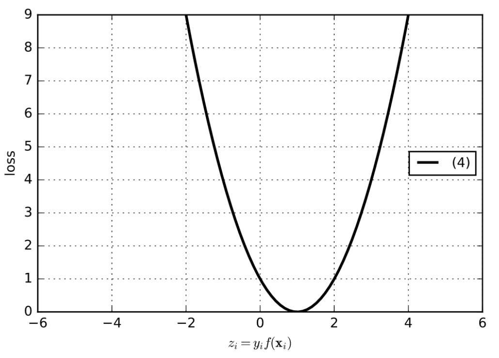

### 中文题意
观察题图中的分类损失。描述使用这种损失训练的分类器会有什么性质，并解释原因。你认为它是好的还是不好的分类损失？图中横轴为 $z_i=y_i f(x_i)$。

### English answer
The squared-shaped loss targets z=1. Large tail gradients make it sensitive to extreme errors, while scores above 1 penalize confidently correct examples unnecessarily. Both effects can make fitting less robust, especially with noisy labels.

### 中文对应答案
这个平方形损失把$z=1$作为目标。两端较大的梯度使它对极端错误敏感；分数超过1时，它又会不必要地惩罚高置信度的正确预测。这两点都可能使拟合不够稳健，尤其是在标签有噪声时。

## MT026 · V形损失：最优点为何在z=1？

**题型：** 简答题 / Written response · 读图或公式、判断并说明

**考点：** 分类损失图与错误代价

**出处：** 2021A期中 Q13，原卷第4页（10分）

### English question
Consider the following classification loss function. Describe the properties of the classifier learned with this loss function. Will this be a good classifier? Why or why not? Note: z = y*f(x).

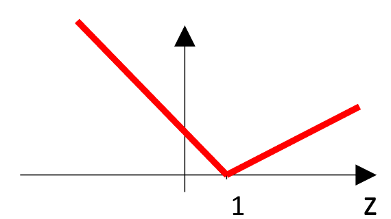

### 中文题意
读题图中的分类损失，描述所得分类器的性质。它是好的分类器吗？说明理由。横轴 $z=yf(x)$，图中两侧均为直线，在z=1处达到最小值。

### English answer
The loss is minimized at z=1 and grows linearly on both sides. It corrects wrong or small-margin predictions with bounded tail slopes, but also penalizes confidently correct scores above 1. The latter is unnecessary for margin classification; it does not prove universally poor accuracy.

### 中文对应答案
损失在$z=1$处最小，并向两侧线性增长。它能修正错误预测或间隔较小的预测，两端斜率的绝对值有界；但分数超过1时，也会惩罚高置信度的正确预测。后一种惩罚对基于间隔的分类没有必要，但这并不证明它在所有任务上准确率都很差。

## MT051 · 负间隔也零损失：分类器会放过什么？

**题型：** 简答题 / Written response · 读图或公式、判断并说明、作图

**考点：** 分类损失图与错误代价

**出处：** 2023A期中 Q13，原卷第10页（10分）

### English question
Consider the following classification loss function. Describe the properties of the classifier learned with this loss function. Will this be a good classifier? Why or why not? Draw a figure of an example of a linear classifier trained with this loss. Note: z = y*f(x).

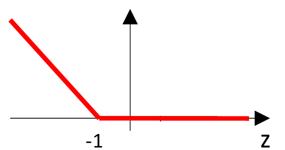

### 中文题意
描述题图所示分类损失训练出的分类器性质，判断它是否合适并说明理由。再画一幅采用此损失的线性分类器例子。横轴 $z=yf(x)$；曲线在z=−1处降至0，之后为0。

### English answer
A representative function with this shape is $L(z)=\max(0,-1-z)$; the vertical scale is not specified. Every −1≤z<0 example is misclassified but has zero loss, so minimizing this objective need not correct it. It is therefore unsuitable as a sole objective for enforcing correct classification.

For an explicit example use f(x)=0.1x+0.5 with (x,y)=(-1,-1) and (1,+1). The signed scores are −0.4 and 0.6; both losses are zero, but the negative example is classified positive. Draw the boundary x=−5 and the two points to its right, with opposite true labels.

### 中文对应答案
具有这种形状的一个代表性函数是$L(z)=\max(0,-1-z)$；原图没有指定纵轴尺度。所有满足$-1\le z<0$的样本都被分错，却有零损失，因此最小化这个目标未必会纠正它们。它不适合作为促使模型正确分类的唯一目标。

具体例子可取$f(x)=0.1x+0.5$，两个样本为$(x,y)=(-1,-1)$和$(1,+1)$。带标签的分数分别为−0.4和0.6，损失都为0，但负类样本被判成了正类。画图时，把边界画在$x=-5$，两个真实标签相反的样本都位于边界右侧。

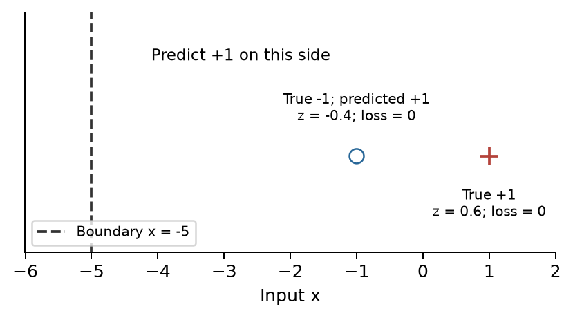

*答案示例图 / Answer example*

## MT039 · 饱和的非凸分类损失

**题型：** 简答题 / Written response · 读图或公式

**考点：** 分类损失图与错误代价

**出处：** 2021B*期中 Q13，原卷第4页（10分）

### English question
Consider the following classification loss function. Describe the properties of the classifier learned with this loss function. Note: z = y*f(x).

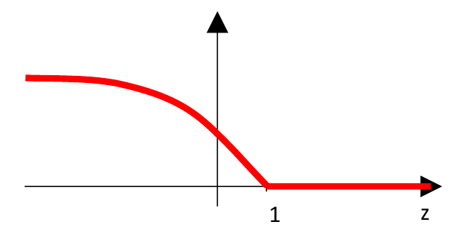

### 中文题意
描述题图所示损失训练出来的分类器会有哪些性质。横轴 $z=yf(x)$；z≥1后损失为0，向很负的z方向，曲线逐渐变平。

### English answer
The loss is zero for z≥1 and saturates at a high level for very negative z. Its left-tail slope approaches zero, limiting extreme points’ gradient influence but potentially leaving wrong predictions unrecovered. The shape is nonconvex, making optimization harder. The decreasing quantity is slope magnitude, not the loss value.

### 中文对应答案
当$z\ge1$时损失为0；当z是很大的负数时，损失在较高水平饱和。左端斜率趋于0，限制了极端样本对梯度的影响，但也可能使错误预测得不到纠正。这个形状是非凸的，优化更困难。减小的是斜率的绝对值，而不是损失值。

## MT065 · 比较Logistic、Hinge和Exponential损失

**题型：** 简答题 / Written response · 比较、排序

**考点：** 分类损失图与错误代价

**出处：** 2025A期中 Q9，原卷第6页（10分）

### English question
Logistic Regression and Support Vector Machine (SVM), and Adaboost are all commonly used classifiers.

1. What is the key difference in the optimization objective of Logistic Regression and SVM? [6 marks]

2. Given this picture, please describe the three algorithms' sensitivity to outliers in descending order, and explain why. [4 marks]

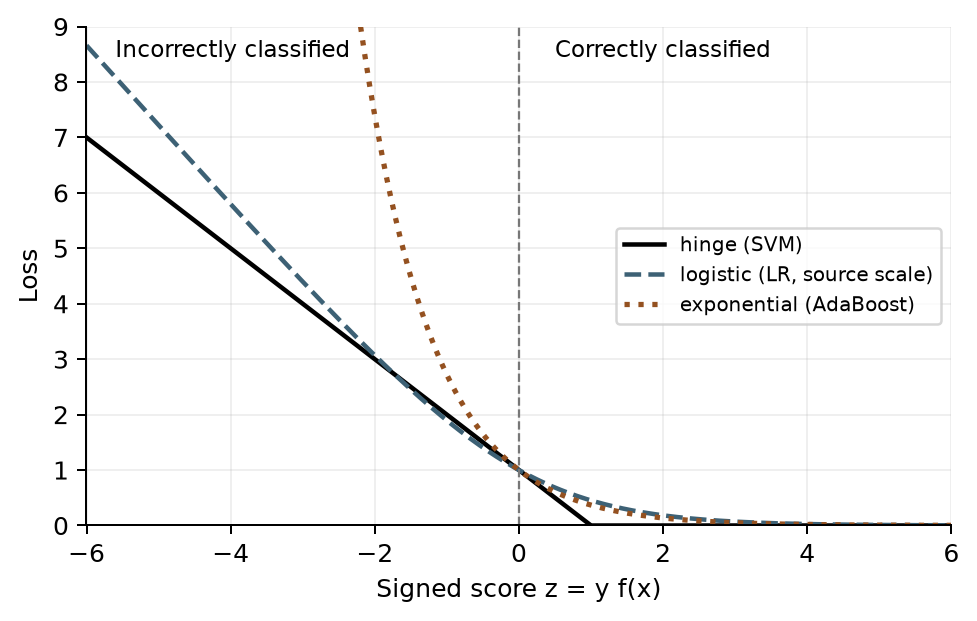

*按原卷曲线重绘并去掉手写批注；保留原图中LR的相对缩放，比较以题图为准。 / Clean redraw preserving the displayed relative scaling.*

### 中文题意
Logistic Regression、SVM和AdaBoost都是常见分类器。

1. [6分] LR与SVM的优化目标主要有什么区别？
2. [4分] 根据题图，将三种算法对异常点的敏感程度从高到低排序，并解释。图中横轴为有符号分数z，负值表示错分，正值表示分对。

### English answer
1. Logistic regression minimizes conditional log-loss, log(1+exp(−z)), usually with regularization. A soft-margin SVM minimizes a weight-norm penalty plus hinge loss max(0,1−z), balancing margin and violations.
2. **For the far-negative-margin region in the supplied figure: AdaBoost > LR > SVM.** Exponential loss has the steepest tail, so extreme misclassifications exert the strongest gradient influence. The plotted LR tail is steeper than the hinge tail. This comparison depends on the figure’s loss scaling; it is not a universal ranking of the algorithms.

### 中文对应答案
1. 逻辑回归最小化条件对数损失$\log(1+\exp(-z))$，通常还带有正则化。软间隔SVM最小化权重范数惩罚与hinge损失$\max(0,1-z)$之和，在扩大间隔和允许违反约束之间作权衡。
2. **在原图的远端负间隔区域，影响大小为AdaBoost > LR > SVM。** 指数损失的曲线最陡，因此极端错分样本对梯度的影响最强。图中LR左端也比hinge损失更陡。这一比较取决于图中各损失的缩放方式，不是三种算法普遍成立的排名。

## MT007 · 筛查任务：漏诊比误报更贵

**题型：** 简答题 / Written response · 提出办法、解释

**考点：** 分类损失图与错误代价

**出处：** 2020B期中Quiz Q7，原卷第3页（10分）；2023B期中 Q13，原卷第10页（10分）

### English question
You have been asked to build a classifier for an early screening test for diagnosing cancer. After the screening test, a more expensive advanced test will be used to confirm the result. For the screening test, you are given a feature vector, and the goal is to predict whether or not the person has cancer (positive or negative). Since it is a screening test, the classifier should classify all people with cancer as positive, while it is okay for some people without cancer to be misclassified as positive. Discuss two methods for getting this desired behavior from the classifier.

### 中文题意
设计癌症早期筛查二分类器。输入是特征向量，输出阳性或阴性；阳性者还会做更昂贵的确诊检查。目标是将所有癌症患者判为阳性，不漏掉病例，允许部分健康者被误报。讨论两种达到这种偏好的方法。

### English answer
1. Give positive/cancer cases or false-negative errors a larger training cost, so missing a positive is penalized more.
2. Lower the threshold for predicting the positive class. If positive is predicted when f(x)>t, lower t; for a calibrated positive-class probability, lower the probability threshold below the usual 0.5 as appropriate.

Choose the threshold on validation data using sensitivity and false-positive cost. These choices favour recall but cannot guarantee zero false negatives on unseen patients.

### 中文对应答案
1. 在训练时，给阳性／癌症样本或假阴性错误更高的代价，使漏掉阳性受到更大的惩罚。
2. 降低预测为阳性的阈值。如果规则是$f(x)>t$时判为阳性，就降低t；如果输出是经过校准的阳性概率，则可适当把概率阈值降到通常的0.5以下。

应在验证数据上，结合灵敏度与假阳性的代价选择阈值。这些调整有利于提高召回率，但不能保证对未见过的患者零漏诊。

## MT023 · 1000名受试者中只有50名阳性

**题型：** 简答题 / Written response · 诊断问题、提出办法

**考点：** 分类损失图与错误代价

**出处：** 2021A期中 Q10，原卷第4页（10分）；2023A期中 Q10，原卷第7页（10分）

### English question
You are working for a hospital to build a classifier as a cost-effective screening test for a lung disease based on the patient’s demographic data and saliva sample. If the classifier predicts positive, then the patient will do a follow-up CT scan that is more costly and very accurate. You have collected a dataset of 1000 patients, of which 50 have the lung disease. What are the key issues to consider when training and testing your classifier? How do you address these key issues during training and testing?

### 中文题意
医院用人口信息和唾液样本做肺病筛查，阳性者再做更贵且准确的CT。数据共1000人，50人患病。训练和测试应考虑哪些关键问题？怎样处理？

### English answer
There are two distinct issues: **class imbalance** (50 positives versus 950 negatives) and **asymmetric error costs** (missing disease is more costly than sending someone for CT). Use stratified training/validation splits and positive-class weighting or appropriate resampling within training. Select a lower positive threshold using validation data, and report sensitivity/recall, specificity and the confusion matrix rather than accuracy alone. Keep the test set separate.

### 中文对应答案
这里有两个不同的问题：**类别不平衡**，即50名阳性、950名阴性；以及**错误代价不对称**，即漏诊比让人多做一次CT的代价更高。训练集和验证集应分层划分，在训练数据内部使用阳性类别加权或合适的重采样。通过验证数据选择较低的阳性阈值，报告灵敏度／召回率、特异度和混淆矩阵，不能只报告准确率。测试集单独保留。

## MT035 · 正常邮件被大量拦截怎么办？

**题型：** 简答题 / Written response · 提出办法、解释

**考点：** 分类损失图与错误代价

**出处：** 2021B*期中 Q9，原卷第4页（10分）

### English question
You have been asked to build a classifier for detecting junk email. You are given a training dataset, which has more junk email than regular email. You trained the model with logistic regression. However, your classification model predicts most emails as spam, so that you will hardly receive any email at all. What are two approaches to fix this problem? Give reasons why these approaches will work.

### 中文题意
邮件分类训练集中垃圾邮件多于正常邮件。逻辑回归把大多数邮件都判成垃圾，几乎收不到邮件。提出两种修复方法并说明理由。

### English answer
Increase the cost/weight of misclassifying regular email during training, so blocking a legitimate message incurs a larger penalty. Also raise the threshold for calling an email spam: if $p=P(\mathrm{spam}\mid x)$ and spam is predicted when $p>t$, increasing $t$ requires stronger evidence before blocking a message. Collecting more representative regular-mail training data is another option. Select the tradeoff on validation data and track false positives on regular mail.

### 中文对应答案
训练时提高把正常邮件误判为垃圾邮件的代价或权重，让误拦正常邮件受到更大的惩罚。同时提高判为垃圾邮件的阈值：若$p=P(\mathrm{spam}\mid x)$，且$p>t$时判为垃圾邮件，那么提高$t$就要求模型有更强的证据才拦截邮件。也可以增加有代表性的正常邮件训练数据。通过验证数据选择取舍，并持续查看正常邮件被误拦截的情况。

## MT067 · 链式求导与两层网络反传

**题型：** 简答题 / Written response · 计算推导

**考点：** 神经网络与链式法则

**出处：** 2025A期中 Q13，原卷第10页（10分）

### English question
(a) Warm-up question (you need to give detailed steps; you may define intermediate variables accordingly): calculate the derivative of y with respect to x using the chain rule.

$$
y=\left(1+e^{\sqrt[3]{3x^2}+\tan(5x)}\right)^{-1}.
$$

(b) Please first explain the forward process with respect to the graph below and then calculate

$$
\frac{\partial L}{\partial a_i},\qquad
\frac{\partial L}{\partial g_1},\qquad
\frac{\partial L}{\partial w_j}.
$$

Hint: $A\in\mathbb R^{m\times m}$ and $W\in\mathbb R^{m\times n}$ are matrices; $a_i$ and $w_j$ are general representations of each weight vector in A and W, respectively. For $g_1\to z$ and $g_2\to f$, any proper functions are fine.

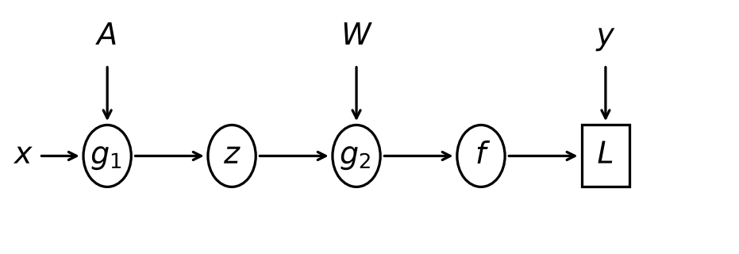

*按原卷重绘的前向结构示意图；省略原图中的反向梯度提示，保留本题所需节点与参数箭头。 / Simplified forward graph redrawn from the exam; backward-gradient annotations are omitted, while the required nodes and parameter arrows are retained.*

### 中文题意
(a) 用链式法则求下式对x的导数，给出详细步骤，可定义中间变量：

$$
y=\left(1+e^{\sqrt[3]{3x^2}+\tan(5x)}\right)^{-1}.
$$

(b) 解释题图的前向过程，然后求 $\partial L/\partial a_i$、$\partial L/\partial g_1$ 和 $\partial L/\partial w_j$。题设 $A\in\mathbb R^{m\times m}$、$W\in\mathbb R^{m\times n}$；$a_i,w_j$分别表示相应矩阵中的权重向量。允许为 $g_1\to z$、$g_2\to f$ 选择合适函数。

### English answer
(a) Let $v=3x^2$, $u=v^{1/3}+\tan(5x)$ and $y=(1+e^u)^{-1}$. Where $x\ne0$ and $\cos(5x)\ne0$, the inner derivatives are

$$
\frac{dv}{dx}=6x,\qquad
\frac{d(v^{1/3})}{dv}=\frac13v^{-2/3},\qquad
\frac{d\tan(5x)}{dx}=5\sec^2(5x).
$$

Apply the chain rule to each part of $u$, then to $y$:

$$
\frac{du}{dx}=\frac13v^{-2/3}(6x)+5\sec^2(5x)
=\frac{2x}{(3x^2)^{2/3}}+5\sec^2(5x),
$$

$$
\frac{dy}{du}=-(1+e^u)^{-2}e^u,
\qquad
\frac{dy}{dx}=-\frac{e^u}{(1+e^u)^2}
\left[\frac{2x}{(3x^2)^{2/3}}+5\sec^2(5x)\right].
$$

(b) Choose a tanh hidden layer and a linear output, as permitted, and leave the unspecified loss as $L(f,y)$. Treat $a_i$ and $w_j$ as columns:

$$
g_1=A^Tx,\quad z=\tanh(g_1),\quad
g_2=W^Tz,\quad f=g_2,\quad L=L(f,y).
$$

Let $\delta_2=\nabla_f L$. Since $f_j=w_j^Tz$ and $dz_i/dg_{1i}=1-z_i^2$, the chain rule gives

$$
\frac{\partial L}{\partial z_i}=\sum_{j=1}^n W_{ij}\delta_{2j},\qquad
\delta_{1i}=\frac{\partial L}{\partial g_{1i}}
=(1-z_i^2)\sum_{j=1}^n W_{ij}\delta_{2j}.
$$

Thus $\delta_1=(W\delta_2)\odot(1-z^2)$, where $\odot$ denotes elementwise multiplication. Because $g_{1i}=a_i^Tx$ has derivative $x$ with respect to $a_i$, and $f_j=w_j^Tz$ has derivative $z$ with respect to $w_j$,

$$
\frac{\partial L}{\partial g_1}=\delta_1,\qquad
\frac{\partial L}{\partial a_i}=x\,\delta_{1i},\qquad
\frac{\partial L}{\partial w_j}=z\,\delta_{2j}.
$$

Here $\delta_1$ and $x$ are $m$-dimensional, $\delta_2$ is $n$-dimensional and each column gradient is $m$-dimensional. For half-squared error, $\delta_2=f-y$; another loss requires its own derivative.

### 中文对应答案
(a) 令$v=3x^2$，$u=v^{1/3}+\tan(5x)$，$y=(1+e^u)^{-1}$。在$x\ne0$且$\cos(5x)\ne0$处，内层各项的导数为

$$
\frac{dv}{dx}=6x,\qquad
\frac{d(v^{1/3})}{dv}=\frac13v^{-2/3},\qquad
\frac{d\tan(5x)}{dx}=5\sec^2(5x).
$$

先对$u$的各部分使用链式法则，再对$y$求导：

$$
\frac{du}{dx}=\frac13v^{-2/3}(6x)+5\sec^2(5x)
=\frac{2x}{(3x^2)^{2/3}}+5\sec^2(5x),
$$

$$
\frac{dy}{du}=-(1+e^u)^{-2}e^u,
\qquad
\frac{dy}{dx}=-\frac{e^u}{(1+e^u)^2}
\left[\frac{2x}{(3x^2)^{2/3}}+5\sec^2(5x)\right].
$$

(b) 按题目允许的选择，隐藏层使用tanh，输出层使用线性函数；题目未指定的损失保留为$L(f,y)$。把$a_i$和$w_j$视为列向量：

$$
g_1=A^Tx,\quad z=\tanh(g_1),\quad
g_2=W^Tz,\quad f=g_2,\quad L=L(f,y).
$$

令$\delta_2=\nabla_f L$。由$f_j=w_j^Tz$及$dz_i/dg_{1i}=1-z_i^2$，链式法则给出

$$
\frac{\partial L}{\partial z_i}=\sum_{j=1}^n W_{ij}\delta_{2j},\qquad
\delta_{1i}=\frac{\partial L}{\partial g_{1i}}
=(1-z_i^2)\sum_{j=1}^n W_{ij}\delta_{2j}.
$$

因此$\delta_1=(W\delta_2)\odot(1-z^2)$，其中$\odot$表示逐元素相乘。$g_{1i}=a_i^Tx$对$a_i$的导数是$x$，$f_j=w_j^Tz$对$w_j$的导数是$z$，所以

$$
\frac{\partial L}{\partial g_1}=\delta_1,\qquad
\frac{\partial L}{\partial a_i}=x\,\delta_{1i},\qquad
\frac{\partial L}{\partial w_j}=z\,\delta_{2j}.
$$

其中$\delta_1$和$x$是$m$维向量，$\delta_2$是$n$维向量，每个列参数的梯度都是$m$维。若损失为平方误差的一半，则$\delta_2=f-y$；若采用其他损失，需要使用相应的导数。

## MT066 · 梯度消失：为什么深度和激活函数有关？

**题型：** 简答题 / Written response · 解释、计算推导

**考点：** 神经网络与链式法则

**出处：** 2025A期中 Q10，原卷第7页（10分）

### English question
(a) [4 marks] Explain what is the “vanishing gradient” problem.

(b) [3 marks] Explain mathematically why “deeper” networks are more prone to this problem. You may use equations or a mathematical description.

(c) [3 marks] Compared with the Sigmoid activation function, why can the ReLU activation function alleviate this problem?

### 中文题意
(a) [4分] 解释梯度消失问题。(b) [3分] 用数学说明为什么更深网络更容易出现这个问题。(c) [3分] 相比Sigmoid，ReLU为什么能缓解它？

### English answer
(a) Gradients reaching earlier layers can become very small, so those parameters learn slowly.
(b) Backpropagation multiplies local Jacobians. On a scalar path, $\partial h_L/\partial h_0$ is the product of weight and activation derivatives. Sigmoid derivatives are at most 1/4; with unit weights, a path through L sigmoids has gradient magnitude at most $(1/4)^L$.
(c) An active ReLU has derivative 1, avoiding sigmoid's saturating factor on that path. Negative ReLU inputs have derivative zero, and weights still affect the product, so ReLU is not a universal cure.

### 中文对应答案
(a) 传到前面各层的梯度可能变得很小，使这些层的参数学习得很慢。

(b) 反向传播会连乘各处的局部Jacobian矩阵。在一条标量路径上，$\partial h_L/\partial h_0$是沿途权重与激活函数导数的乘积。Sigmoid的导数最大为1/4；若权重均为1，经过L个sigmoid的路径，其梯度绝对值至多为$(1/4)^L$。

(c) ReLU处于激活状态时导数为1，在这条路径上避免了sigmoid带来的饱和衰减因子。但ReLU输入为负时导数为0，权重也仍会影响连乘结果，因此ReLU不能普遍解决所有梯度消失问题。

## MT003 · 历史拓展：Gaussian Process的假设

**题型：** 选择题（多选） / Multiple select

**考点：** 历史范围拓展：Gaussian Process

**出处：** 2020B期中Quiz Q3，原卷第2页（5分）

历史期中原题；需要高斯过程背景，不作为当前Lecture 1–5已完整讲授的内容。

### English question
Which statements about Gaussian Process regression (GPR) are correct? (select all that apply)

A) GPR is defined as the Bayesian linear regression whose linear kernel is replaced by the Gaussian/RBF kernel.

B) GPR only has a closed form solution when the observation noise is Gaussian.

C) One assumption in the Gaussian process prior is that two function values are more correlated when the corresponding inputs are close together.

D) The reason why GPR is not good for large datasets is that it only has a few parameters and thus limited model complexity.

E) GPR assumes the input data points are i.i.d. (independently and identically distributed).

### 中文题意
关于高斯过程回归GPR，哪些说法正确？多选。

A）GPR被定义为：将贝叶斯线性回归的线性核换成Gaussian/RBF核。B）只有观测噪声为高斯时，GPR才有闭式解。C）高斯过程先验的一个假设是，输入越近，对应函数值的相关性越高。D）GPR不适合大数据是因为参数少、模型复杂度有限。E）GPR假设输入数据点独立同分布。

### English answer
**B and C under the course’s Gaussian-likelihood and RBF-kernel assumptions.** Gaussian noise gives the usual analytic posterior; RBF gives nearby inputs higher covariance. GP kernels need not be RBF, dense inference is costly, and inputs need not be i.i.d. B’s “only” and C are not universal GP definitions.

### 中文对应答案
**在课程采用的高斯似然与RBF核假设下，B、C正确。** 高斯噪声使通常的后验有解析形式；RBF核让相近输入具有更高的协方差。GP的核不必是RBF，精确稠密推断的计算成本较高，输入也不必独立同分布。B中的“只有”以及C都不是GP的普遍定义。

## MT036 · 历史拓展：音乐地理回归，GP还是RF？

**题型：** 简答题 / Written response · 比较

**考点：** 历史范围拓展：Gaussian Process

**出处：** 2021B*期中 Q10，原卷第4页（10分）

历史期中原题；GPR属于本轮讲义主线之外的背景。

### English question
Geographical origins of music are related to the audio features in music. Suppose we have 10,597 music segments from different regions of the world, where each audio segment is represented by a 68-dimensional vector, and the region is denoted by latitude and longitude coordinates. We know there are some outliers in the dataset and some regions have apparently more music data than others. Suppose we want to choose Gaussian process regression or random forest regression to predict the region coordinates from the audio feature vector. For this specific regression task, what are the advantages and disadvantages of using these Gaussian process regression or random forest regression?

### 中文题意
共有10,597段世界各地音乐，每段68维音频特征，目标是经纬度。存在异常值，且部分地区样本远多于其他地区。比较Gaussian Process Regression与Random Forest Regression在这个任务中的优缺点。

### English answer
A standard GP provides a predictive mean and model-based uncertainty, useful when coverage is uneven; exact dense fitting on 10,597 samples is computationally costly, and a Gaussian likelihood can be sensitive to output outliers. RF captures nonlinear interactions and is often easier to scale, but ordinary leaf averages can still be affected by outlier targets and do not automatically provide calibrated uncertainty. Evaluate both with region-aware validation; sparse regions and out-of-range predictions remain difficult.

### 中文对应答案
标准GP提供预测均值及基于模型的不确定性，在数据覆盖不均匀时很有用。但对10,597个样本进行精确稠密拟合，计算成本很高；高斯似然也可能对输出异常值敏感。随机森林能捕捉非线性交互，通常更容易扩展到大数据，不过普通的叶节点平均值仍会受异常目标值影响，也不会自动给出经过校准的不确定性。应在验证时考虑地域划分，比较两者；样本稀少的地区和训练范围之外的预测，对它们仍然困难。

## 原卷索引 / Original-paper index

按原卷题号查找本册位置；不同年份的重复题指向同一MT编号。2021B*保留题纸与配套答案的年份冲突。

### 2020B期中Quiz

| 原题 | 本册题号与页码 | 分值 |
|---|---|---|
| Q1 | [MT001](Compact.md#mt001) | 5 |
| Q2 | [MT002](Compact.md#mt002) | 5 |
| Q3 | [MT003](Compact.md#mt003) | 5 |
| Q4 | [MT004](Compact.md#mt004) | 5 |
| Q5 | [MT005](Compact.md#mt005) | 5 |
| Q6 | [MT006](Compact.md#mt006) | 5 |
| Q7 | [MT007](Compact.md#mt007) | 10 |
| Q8 | [MT008](Compact.md#mt008) | 10 |
| Q9 | [MT009](Compact.md#mt009) | 10 |
| Q10 | [MT010](Compact.md#mt010) | 10 |
| Q11 | [MT011](Compact.md#mt011) | 10 |
| Q12 | [MT012](Compact.md#mt012) | 10 |
| Q13 | [MT013](Compact.md#mt013) | 10 |

### 2021A期中

| 原题 | 本册题号与页码 | 分值 |
|---|---|---|
| Q1 | [MT014](Compact.md#mt014) | 5 |
| Q2 | [MT015](Compact.md#mt015) | 5 |
| Q3 | [MT016](Compact.md#mt016) | 5 |
| Q4 | [MT017](Compact.md#mt017) | 5 |
| Q5 | [MT018](Compact.md#mt018) | 5 |
| Q6 | [MT019](Compact.md#mt019) | 5 |
| Q7 | [MT020](Compact.md#mt020) | 10 |
| Q8 | [MT021](Compact.md#mt021) | 10 |
| Q9 | [MT022](Compact.md#mt022) | 10 |
| Q10 | [MT023](Compact.md#mt023) | 10 |
| Q11 | [MT024](Compact.md#mt024) | 10 |
| Q12 | [MT025](Compact.md#mt025) | 10 |
| Q13 | [MT026](Compact.md#mt026) | 10 |

### 2021B*期中

| 原题 | 本册题号与页码 | 分值 |
|---|---|---|
| Q1 | [MT027](Compact.md#mt027) | 5 |
| Q2 | [MT028](Compact.md#mt028) | 5 |
| Q3 | [MT029](Compact.md#mt029) | 5 |
| Q4 | [MT030](Compact.md#mt030) | 5 |
| Q5 | [MT031](Compact.md#mt031) | 5 |
| Q6 | [MT032](Compact.md#mt032) | 5 |
| Q7 | [MT033](Compact.md#mt033) | 10 |
| Q8 | [MT034](Compact.md#mt034) | 10 |
| Q9 | [MT035](Compact.md#mt035) | 10 |
| Q10 | [MT036](Compact.md#mt036) | 10 |
| Q11 | [MT037](Compact.md#mt037) | 10 |
| Q12 | [MT038](Compact.md#mt038) | 10 |
| Q13 | [MT039](Compact.md#mt039) | 10 |

### 2023A期中

| 原题 | 本册题号与页码 | 分值 |
|---|---|---|
| Q1 | [MT040](Compact.md#mt040) | 5 |
| Q2 | [MT041](Compact.md#mt041) | 5 |
| Q3 | [MT042](Compact.md#mt042) | 5 |
| Q4 | [MT043](Compact.md#mt043) | 5 |
| Q5 | [MT044](Compact.md#mt044) | 5 |
| Q6 | [MT045](Compact.md#mt045) | 5 |
| Q7 | [MT046](Compact.md#mt046) | 10 |
| Q8 | [MT047](Compact.md#mt047) | 10 |
| Q9 | [MT048](Compact.md#mt048) | 10 |
| Q10 | [MT023](Compact.md#mt023) | 10 |
| Q11 | [MT049](Compact.md#mt049) | 10 |
| Q12 | [MT050](Compact.md#mt050) | 10 |
| Q13 | [MT051](Compact.md#mt051) | 10 |

### 2023B期中

| 原题 | 本册题号与页码 | 分值 |
|---|---|---|
| Q1 | [MT052](Compact.md#mt052) | 5 |
| Q2 | [MT053](Compact.md#mt053) | 5 |
| Q3 | [MT054](Compact.md#mt054) | 5 |
| Q4 | [MT055](Compact.md#mt055) | 5 |
| Q5 | [MT056](Compact.md#mt056) | 5 |
| Q6 | [MT057](Compact.md#mt057) | 5 |
| Q7 | [MT058](Compact.md#mt058) | 10 |
| Q8 | [MT059](Compact.md#mt059) | 10 |
| Q9 | [MT060](Compact.md#mt060) | 10 |
| Q10 | [MT061](Compact.md#mt061) | 10 |
| Q11 | [MT062](Compact.md#mt062) | 10 |
| Q12 | [MT063](Compact.md#mt063) | 10 |
| Q13 | [MT007](Compact.md#mt007) | 10 |

### 2025A期中

| 原题 | 本册题号与页码 | 分值 |
|---|---|---|
| Q1 | [MT040](Compact.md#mt040) | 5 |
| Q2 | [MT041](Compact.md#mt041) | 5 |
| Q3 | [MT042](Compact.md#mt042) | 5 |
| Q4 | [MT043](Compact.md#mt043) | 5 |
| Q5 | [MT044](Compact.md#mt044) | 5 |
| Q6 | [MT057](Compact.md#mt057) | 5 |
| Q7 | [MT064](Compact.md#mt064) | 10 |
| Q8 | [MT047](Compact.md#mt047) | 10 |
| Q9 | [MT065](Compact.md#mt065) | 10 |
| Q10 | [MT066](Compact.md#mt066) | 10 |
| Q11 | [MT046](Compact.md#mt046) | 10 |
| Q12 | [MT050](Compact.md#mt050) | 10 |
| Q13 | [MT067](Compact.md#mt067) | 10 |
